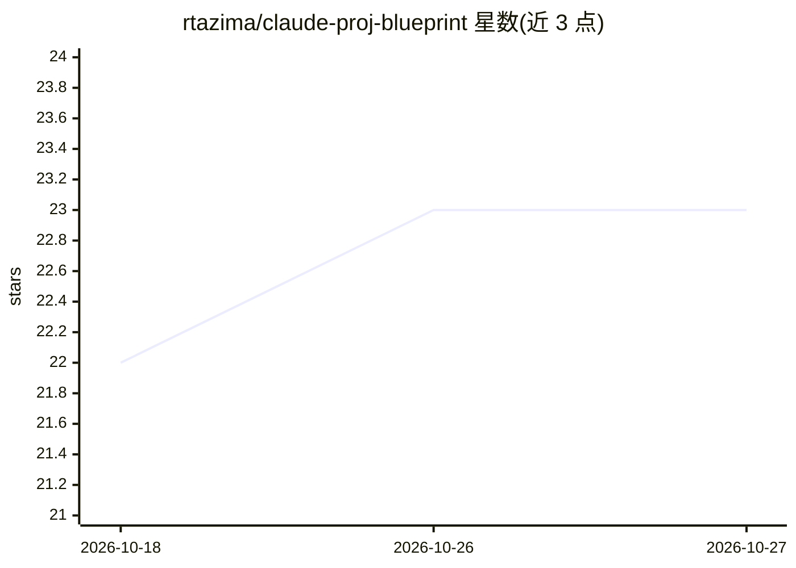

# rtazima/claude-proj-blueprint

⭐ — · [GitHub]() · 个人维护

**面向团队的 Claude Code 分级项目模板（L1-L4）**

为使用 Claude Code、Obsidian 与 Figma 的团队提供按成熟度分级的模块化项目骨架：L1 提供 CLAUDE.md 与文档结构，L2 增加 Skills 与斜杠命令，L3 增加 Hooks 治理门禁与规范评审，L4 增加专用 Agent 团队与向量记忆（Chroma/pgvector）。含 16 类可插拔规范模块与 [SPEC] 扩展点约定，通过 git clone 使用；Obsidian 以 docs/ 作为 vault，Figma 为可选集成。

## 筛选速览

| 维度 | 判定 | 备注 |
|---|---|---|
| AI 角色 | `ai-ecosystem` | LLM/agent 周边工具 |
| 许可风险 | `permissive` | — |
| 部署形态 | `library` | 以包/库形式分发 |
| 模型依赖 | — | README 未给出锁定关系 |
| 硬件要求 | — | 无带数字的原话,不猜 |
| 安装摩擦 | `low` | 无编译、无系统依赖或容器化 |
| 成熟度 | — | 结构信号不足 |

## 能力要点

- L1-L4 四级成熟度结构，逐级叠加能力
- 16 个可插拔规范模块（合规/安全/可观测性/i18n 等）
- [SPEC] 扩展点约定：框架定位置、团队填内容
- L4 向量记忆支持 Chroma（本地默认）或 pgvector 语义检索

## 适用场景

- 团队从零搭建与 Claude Code 协作的项目结构
- 按成熟度逐步引入 Hooks 治理与多 Agent 工作流
- 用 Obsidian 管理互联的 PRD/ADR/规范文档

## 场景标签

 · 领域:开发者工具/AI 工程模板

## 证据(README 行号)

> L3: A modular, level-based project template for teams building software with **Claude Code**, **Obsidian**, and **Figma*
> L20: |**L1**|ReAct loop|Solo devs, MVPs|`CLAUDE.md` + docs structure + Obsidian vault|

## 星数曲线

2026-10-18 22 → 2026-10-27 23（+1）

---
*卡片 v1 · prompt 1.4 · 生成 2026-10-27 · 置信度 mid · 依据 README sha `8b921125dc8c` · [字段定义](../../DATASET.md)*
