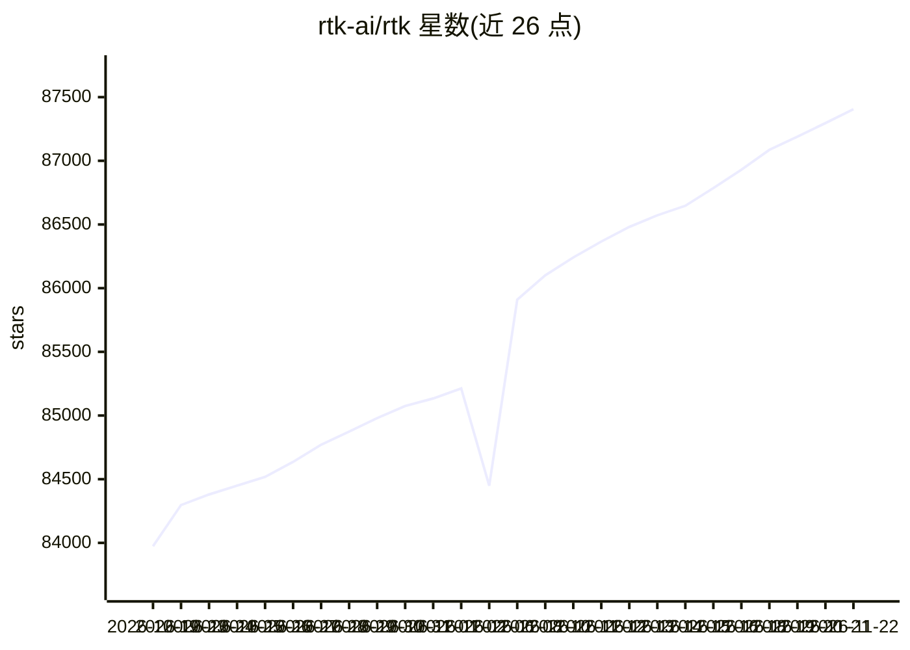

# rtk-ai/rtk

⭐ 87,405 · Rust · Apache-2.0 · 推送 2026-11-21 · [GitHub](https://github.com/rtk-ai/rtk) · [官网](https://www.rtk-ai.app) · 组织维护

**AI 编码代理的 CLI 输出压缩代理，降低 token 消耗**

一个用 Rust 编写的 CLI 代理工具，插入 AI 编码代理与 shell 之间：代理运行 git、测试、构建等 100+ 常用命令时，RTK 过滤压缩其输出后再交给代理读取，README 声称输出减少 60-90%，每条命令低于 25ms。通过 hook/plugin/rules file 三种方式接入 18 种 AI 编码工具。可选 pipeline 机制可将大文件读取路由到更便宜的模型、经可选 rtk-proxy 清理 API 流量；另有面向企业的商业版 RTK Pro 提供网关、成本控制与审计。`rtk gain` 在本地统计节省量。

## 筛选速览

| 维度 | 判定 | 备注 |
|---|---|---|
| AI 角色 | `ai-ecosystem` | LLM/agent 周边工具 |
| 许可风险 | `permissive` | Apache-2.0 |
| 部署形态 | `library` | 以包/库形式分发 |
| 模型依赖 | — | README 未给出锁定关系 |
| 硬件要求 | — | 无带数字的原话,不猜 |
| 安装摩擦 | `low` | 无编译、无系统依赖或容器化 |
| 成熟度 | — | 结构信号不足 |

## 动量与使用信号

- 维护:`active` — 距上次 push 0.8 天,年发版 100,172 位贡献者
- 涨星:近 1 天 **+159**(自 20261016 起算)
- 平台:WINDOWS / MACOS / LINUX · 协议:—

## 能力要点

- 压缩 100+ 常用开发命令（git/cargo/pytest/docker 等）的输出，单命令低于 25ms
- 通过 hook/plugin/rules file 接入 18 种 AI 编码工具，`rtk init -g` 一条命令安装
- 可选 pipeline：大文件交给更便宜的模型、经 rtk-proxy 清理 API 流量
- `rtk gain` 本地统计节省的 token 与命令历史

## 适用场景

- 让 Claude Code 等编码代理读取更短的命令输出以降低 token 账单
- 团队统一管理多个 AI 代理的成本、密钥与审计
- 把大文件读取路由给更便宜的模型而不进入代理上下文

## 场景标签

`编码 Agent` `模型网关` · 领域:Agent 开发

## 证据(README 行号)

> L3:  The cost reduction engine for AI coding agents.
> L35: Test runs, diffs, logs and builds are compressed before your agent reads them. 100+ commands, under 25 ms per comma
> L187: RTK supports 18 AI coding tools. With a **hook** or **plugin**, `rtk init` installs it and compression is automati

## 星数曲线

2026-10-19 83,974 → 2026-11-22 87,405（+3,431）

---
*卡片 v1 · prompt 1.4 · 生成 2026-11-22 · 置信度 mid · 依据 README sha `b3540bc29a4c` · [字段定义](../../DATASET.md)*
