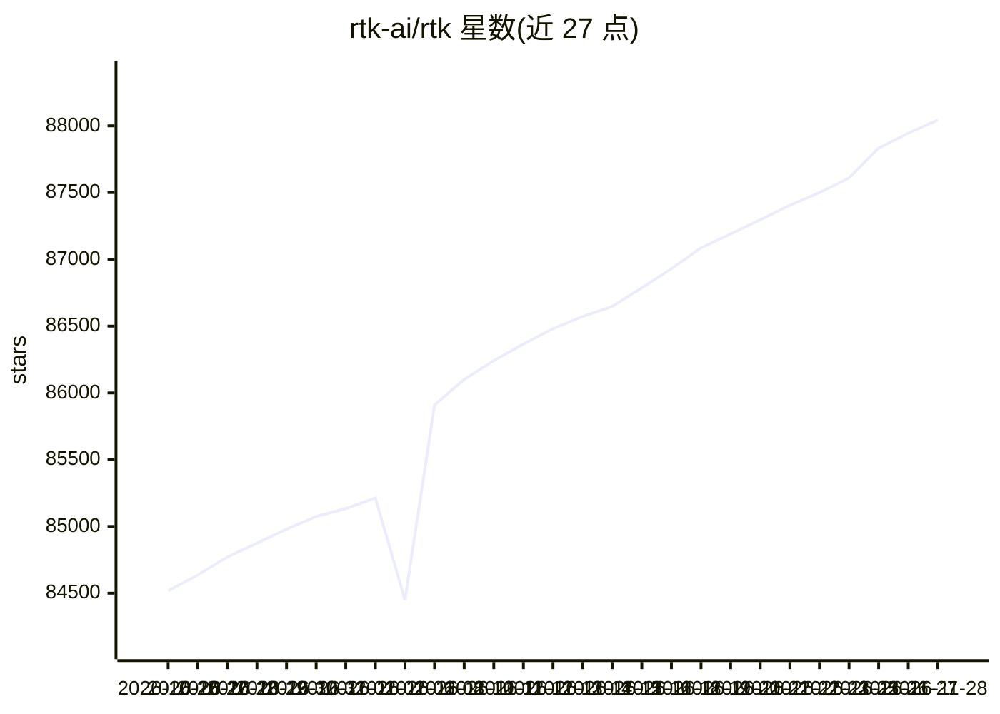

# rtk-ai/rtk

⭐ 88,044 · Rust · Apache-2.0 · 推送 2026-11-27 · [GitHub](https://github.com/rtk-ai/rtk) · [官网](https://www.rtk-ai.app) · 组织维护 · 中文 README

**给 AI 编码代理压缩命令输出的 CLI，降低 token 消耗**

以 Rust 单二进制提供的 CLI 代理，注册为 agent 的 hook 后拦截并压缩 shell 命令输出（测试、diff、日志、构建等 100+ 命令），使 agent 读取的输出减少最多 90%；`rtk gain` 在本地统计节省量。可选 pipeline 文件可进一步压缩全部工具输出、把大文件读取路由到更便宜的模型、经可选 proxy 清理 provider API 流量。面向使用 AI 编码工具的开发者，官方支持 18 种 agent 工具；另有面向企业的 RTK Pro 商业版（网关、成本控制、审计等）。

## 筛选速览

| 维度 | 判定 | 备注 |
|---|---|---|
| AI 角色 | `ai-ecosystem` | LLM/agent 周边工具 |
| 许可风险 | `permissive` | Apache-2.0 |
| 部署形态 | `library` | 以包/库形式分发 |
| 模型依赖 | — | README 未给出锁定关系 |
| 硬件要求 | — | 无带数字的原话,不猜 |
| 安装摩擦 | `low` | 无编译、无系统依赖或容器化 |
| 成熟度 | — | 结构信号不足 |

## 动量与使用信号

- 维护:`active` — 距上次 push 0.8 天,年发版 100,172 位贡献者
- 涨星:近 1 天 **+159**(自 20261016 起算)
- 平台:WINDOWS / MACOS / LINUX · 协议:—

## 能力要点

- 压缩 100+ 常用开发命令输出，每命令开销低于 25ms，无需配置
- rtk gain 本地统计节省量与历史图表
- pipeline 文件机制：共享安装、大文件路由到指定更便宜模型
- 支持 18 种 AI 编码工具，通过 hook/plugin/rules 文件接入

## 适用场景

- 让 Claude Code 等 agent 运行测试时少读冗长输出
- 团队为多名使用 AI agent 的开发者控制 token 开销
- 把大文件读取交给更便宜的模型处理

## 场景标签

 · 领域:开发者工具/AI 编码辅助

## 证据(README 行号)

> L3:  The cost reduction engine for AI coding agents.
> L35: Test runs, diffs, logs and builds are compressed before your agent reads them. 100+ commands, under 25 ms per comma
> L187: RTK supports 18 AI coding tools. With a **hook** or **plugin**, `rtk init` installs it and compression is automati

## 星数曲线

2026-10-26 84,518 → 2026-11-28 88,044（+3,526）

---
*卡片 v1 · prompt 1.4 · 生成 2026-11-24 · 置信度 mid · 依据 README sha `616488ec04a4` · [字段定义](../../DATASET.md)*
