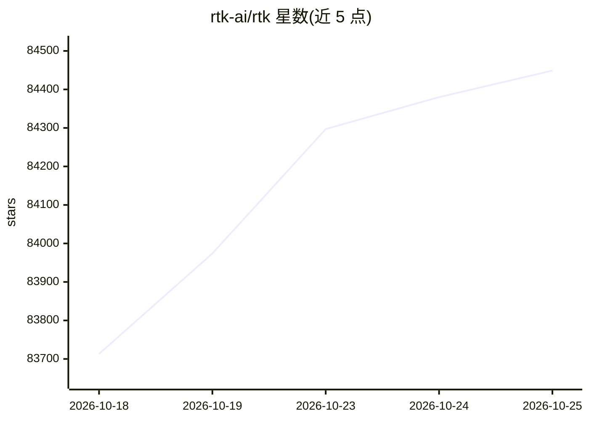

# rtk-ai/rtk

⭐ 84,449 · Rust · Apache-2.0 · 推送 2026-10-23 · [GitHub](https://github.com/rtk-ai/rtk) · [官网](https://www.rtk-ai.app) · 组织维护 · 中文 README

**压缩开发命令输出的 CLI 代理，降低 agent 读取的 token 消耗**

RTK 以 shell hook 方式拦截 agent 的命令调用，在输出进入 LLM 上下文前按命令类型做过滤、分组、截断与去重，覆盖 git、cargo、npm、pytest、docker 等 100+ 命令。单个 Rust 二进制、无运行时依赖，安装后通过 `rtk init` 为各编码 agent 配置集成；`rtk gain` 提供节省统计。部分版本含 BUSL-1.1 授权的可选 proxy 守护进程，将压缩扩展到 provider API 流量。注意 README 明确节省比例仅针对 bash 输出部分，不等于整体账单降幅。

## 筛选速览

| 维度 | 判定 | 备注 |
|---|---|---|
| AI 角色 | `ai-ecosystem` | LLM/agent 周边工具 |
| 许可风险 | `dual` | Apache-2.0 |
| 部署形态 | `library` | 以包/库形式分发 |
| 模型依赖 | — | README 未给出锁定关系 |
| 硬件要求 | — | 无带数字的原话,不猜 |
| 安装摩擦 | `low` | 无编译、无系统依赖或容器化 |
| 成熟度 | — | 结构信号不足 |

## 动量与使用信号

- 维护:`active` — 距上次 push 0.8 天,年发版 100,172 位贡献者
- 涨星:近 1 天 **+159**(自 20261016 起算)
- 平台:WINDOWS / MACOS / LINUX · 协议:—

## 能力要点

- 支持 18 个 AI 编码工具的 hook/规则集成（Claude Code、Copilot、Cursor、Gemini CLI 等）
- 覆盖 100+ 开发命令的输出过滤，宣称 <10ms 开销
- 按 Apache-2.0 与 BUSL-1.1 双版本分发（oss 版无压缩引擎）
- 可选 rtk-proxy 守护进程处理 provider API 流量并支持模型路由

## 适用场景

- 为 Claude Code 等 agent 减少命令输出占用的上下文
- 统计并可视化 agent 会话的 token 节省情况
- 通过代理压缩 agent 的 provider API 请求流量

## 场景标签

 · 领域:LLM 基础设施/开发工具

## 证据(README 行号)

> L31: rtk filters and compresses command outputs before they reach your LLM context. Single Rust binary, 100+ supported c
> L143: RTK supports 18 AI coding tools. Each integration rewrites shell commands to `rtk` equivalents, reducing the bash 
> L147: |**Claude Code**|`rtk init -g`|PreToolUse hook (native binary)|

## 星数曲线

2026-10-18 83,713 → 2026-10-25 84,449（+736）

---
*卡片 v1 · prompt 1.4 · 生成 2026-10-18 · 置信度 high · 依据 README sha `8990ace3aed3` · [字段定义](../../DATASET.md)*
