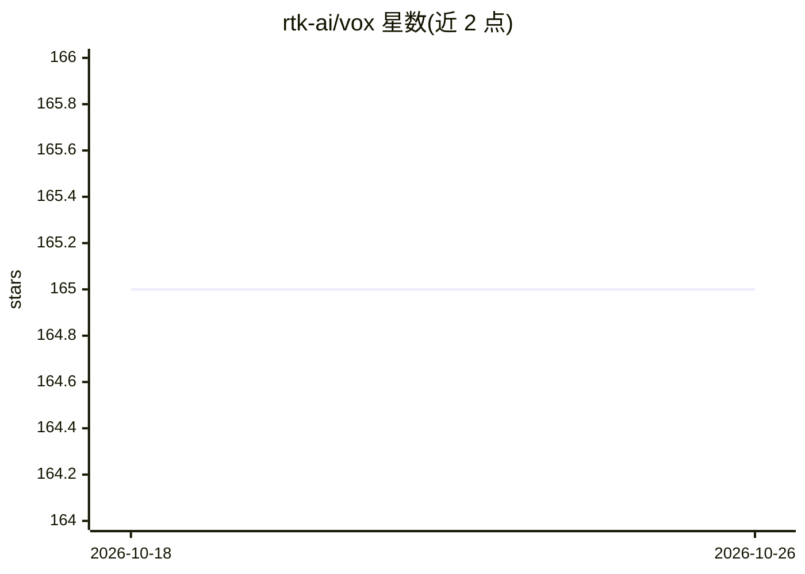

# rtk-ai/vox

⭐ 165 · Rust · Apache-2.0 · 推送 2026-10-06 · [GitHub](https://github.com/rtk-ai/vox) · 组织维护 · 中文 README

**本地 TTS/STT 单文件 Rust 工具，为 AI 编程助手提供语音**

以单一 Rust 二进制在本地运行文本转语音与语音转文字，不依赖 Python 与云服务。TTS 提供 pocket（Kyutai pocket-tts）、piper、qwen-native（Qwen3-TTS）、macOS say 及可选 kokoro 五种后端，STT 使用 Whisper；内置含 14 个工具的 MCP 服务器，并可一条命令配置机器上已安装的 14 种 AI 工具。提供 macOS Apple Silicon（Metal）、Linux x86_64/ARM64（CPU 或 CUDA）与 Windows 的预编译二进制，附安装脚本、Homebrew、.deb/.rpm 等分发方式；Linux 需要 glibc 2.39+、ALSA 与 OpenSSL 3，无 Intel Mac 构建。提供 daemon 模式保持模型驻留以降低延迟。

## 筛选速览

| 维度 | 判定 | 备注 |
|---|---|---|
| AI 角色 | `ai-native` | 本体是模型或模型工具 |
| 许可风险 | `permissive` | Apache-2.0 |
| 部署形态 | `library` | 以包/库形式分发 |
| 模型依赖 | — | README 未给出锁定关系 |
| 硬件要求 | — | 无带数字的原话,不猜 |
| 安装摩擦 | `high` | 编译与系统依赖俱全 |
| 成熟度 | — | 结构信号不足 |

## 能力要点

- 单一 Rust 二进制，本地运行 TTS 与 Whisper STT，无需 Python 与云服务
- 五种 TTS 后端：pocket/piper/qwen-native/say/kokoro（kokoro 需特性编译），部分支持语音克隆
- 内置 14 个工具的 MCP 服务器，可配置 14 种已安装的 AI 工具
- daemon 模式保持模型加载，piper 首声延迟可降至约 0.26-0.32 秒

## 适用场景

- 为 Claude Code 等 AI 编程助手添加语音输入与语音输出
- 在本地离线做低延迟的文本转语音与语音转文字
- 通过 MCP 服务器让 agent 调用语音合成与转录能力

## 场景标签

`语音合成` `语音识别` · 领域:内容生成

## 证据(README 行号)

> L5:  Local voice for AI coding agents: text-to-speech and speech-to-text in one Rust binary.
> L8:  Several TTS backends, Whisper speech-to-text, an MCP server with 14 tools,
> L9:  and one command that configures the AI tools installed on your machine

## 星数曲线

2026-10-18 165 → 2026-10-26 165（+0）

---
*卡片 v1 · prompt 1.4 · 生成 2026-10-22 · 置信度 high · 依据 README sha `4efba2926dd9` · [字段定义](../../DATASET.md)*
