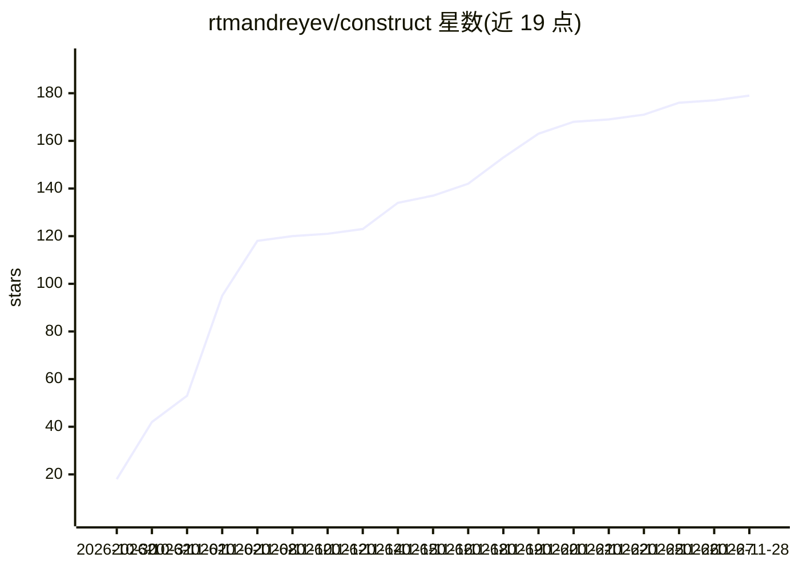

# rtmandreyev/construct

⭐ 179 · Python · Apache-2.0 · 推送 2026-11-24 · [GitHub](https://github.com/rtmandreyev/construct) · [官网](https://rtmandreyev.github.io/construct/) · 个人维护

**为 AI agent 提供持久、可编辑、可溯源的对象建模工具**

Construct 是面向 AI agent 的工具：agent 对某个实物做研究并写出含命名部件、真实尺寸、装配与开合方式的结构化描述，Construct 校验该描述并据此构建；每个部件标注其尺寸与形状是测得、查得还是推测。同一描述可重建为网页动画、带铰链的 3D 模型、打印件、CAD 文件或游戏关卡。多个 construct 可组合成 world。仅依赖 Python 标准库与浏览器，无 API key 与内置网络服务。通过 Hermes 插件、MCP server、命令行与 skills 提供接口。

## 筛选速览

| 维度 | 判定 | 备注 |
|---|---|---|
| AI 角色 | `ai-ecosystem` | LLM/agent 周边工具 |
| 许可风险 | `permissive` | Apache-2.0 |
| 部署形态 | `None` |  |
| 模型依赖 | — | README 未给出锁定关系 |
| 硬件要求 | — | 无带数字的原话,不猜 |
| 安装摩擦 | `medium` | 含编译或系统依赖之一 |
| 成熟度 | — | 结构信号不足 |

## 能力要点

- agent 写描述、Construct 校验并构建，同一描述结果确定
- 每个部件分别标注尺寸与形状的已知程度（测得/查得/推测）
- 导出 Blender、Godot、FreeCAD/STEP、FBX、USD、glTF、OBJ
- 单张照片可生成 world（如 Rain Harbour 游戏关卡）

## 适用场景

- 为 3D 打印机生成带校验的打印件或模型套件
- 从一张照片重建街景或建筑并逐件标注依据
- 为游戏引擎生成带可用铰链的命名部件道具
- 博物馆/档案的重建展示，引用来源并保留推测标记

## 场景标签

 · 领域:AI agent 工具/3D 内容生成

## 证据(README 行号)

> L9: **Construct is a tool for AI agents. It turns everything that can be found out about a thing into one exact,
> L44: - **Construct for Hermes.** A native Hermes plugin. Ask for a thing in plain words and the construct appears live i
> L50: - **Nothing to install.** It needs only Python's standard library and a browser. There are no API keys and no netwo

## 星数曲线

2026-10-30 18 → 2026-11-28 179（+161）

---
*卡片 v1 · prompt 1.4 · 生成 2026-11-27 · 置信度 mid · 依据 README sha `666602ffdd0f` · [字段定义](../../DATASET.md)*
