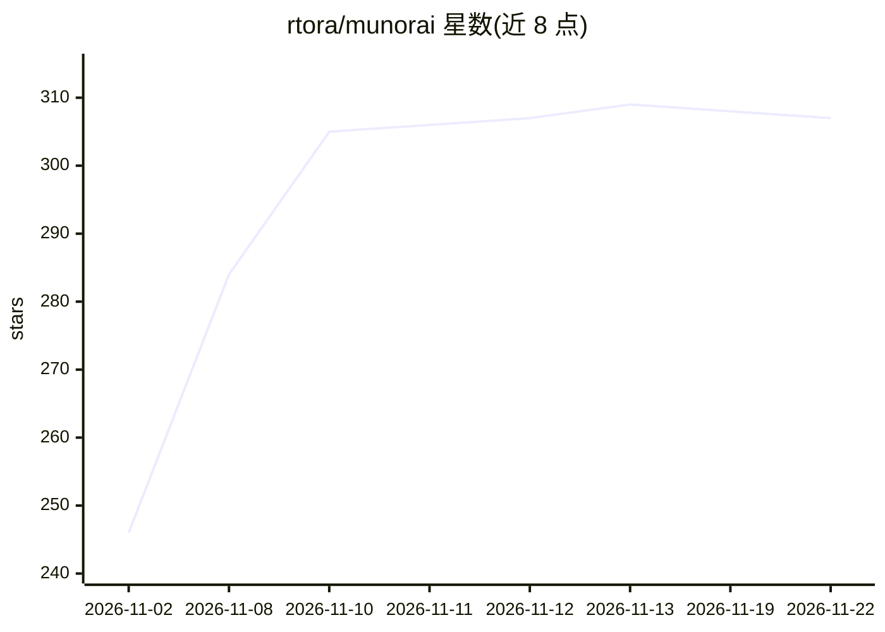

# rtora/munorai

⭐ 307 · 推送 2026-11-02 · [GitHub](https://github.com/rtora/munorai) · [官网](https://munorai.com) · 个人维护

**增强现有 AI 编程工具的接入层工具**

README 仅含营销式简述：宣称让用户已使用的 AI 工具『更省、更快、更便宜』，一次接入后照常工作，并列出兼容 Cursor、Codex、Claude Code 与 Gemini CLI。文档未说明具体机制、安装方式、运行要求或定价模式，未给出代码结构或部署细节，无法从可见内容核实其实现路径，需要跳转外部链接获取更多信息。

## 筛选速览

| 维度 | 判定 | 备注 |
|---|---|---|
| AI 角色 | `ai-ecosystem` | LLM/agent 周边工具 |
| 许可风险 | `none` | — |
| 部署形态 | `None` |  |
| 模型依赖 | — | README 未给出锁定关系 |
| 硬件要求 | — | 无带数字的原话,不猜 |
| 安装摩擦 | `low` | 无编译、无系统依赖或容器化 |
| 成熟度 | — | 结构信号不足 |

## 能力要点

- 宣称兼容 Cursor、Codex、Claude Code、Gemini CLI
- 宣称一次接入、保持原有工作流不变

## 适用场景

- 为已在使用的 AI 编程 CLI 寻求成本或性能优化
- 了解面向 AI 编程工具的增强类产品

## 场景标签

 · 领域:开发者工具/AI 编程

## 证据(README 行号)

> L12: Works with Cursor, Codex, Claude Code, and Gemini CLI.

## 星数曲线

2026-11-02 246 → 2026-11-22 307（+61）

---
*卡片 v1 · prompt 1.4 · 生成 2026-11-17 · 置信度 low · 依据 README sha `49b7969e030f` · [字段定义](../../DATASET.md)*
