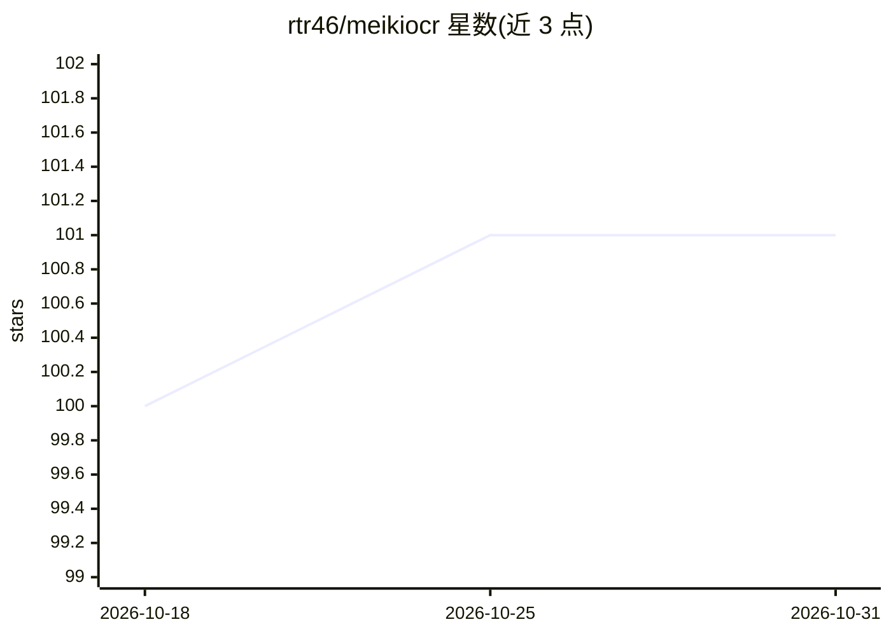

# rtr46/meikiocr

⭐ 101 · Python · Apache-2.0 · 推送 2026-10-23 · [GitHub](https://github.com/rtr46/meikiocr) · 个人维护

**面向日文游戏文本的本地 OCR 管线工具**

Python 编写的两阶段 OCR 管线：先用检测模型定位文本行边界框，再用识别模型逐字符识别，专为本机渲染的日文游戏文本训练。基于 ONNX Runtime 运行，支持 CPU 与 GPU（安装 onnxruntime-gpu），提供 CLI 与 Python API，可输出 JSON（坐标与置信度）、可视化结果，阈值可调。限制：检测上限 64 个文本框、每行 48 字符，竖排文本为 beta 支持，不适用于手写或复杂真实场景文本。

## 筛选速览

| 维度 | 判定 | 备注 |
|---|---|---|
| AI 角色 | `ai-native` | 本体是模型或模型工具 |
| 许可风险 | `permissive` | Apache-2.0 |
| 部署形态 | `library` | 以包/库形式分发 |
| 模型依赖 | — | README 未给出锁定关系 |
| 硬件要求 | — | 无带数字的原话,不猜 |
| 安装摩擦 | `low` | 无编译、无系统依赖或容器化 |
| 成熟度 | `idea` | |

## 能力要点

- 两阶段管线：文本行检测 + 逐字符识别
- 基于 ONNX Runtime，支持 CPU/GPU，跨平台运行
- CLI 与 Python API，支持 JSON 输出与阈值调整
- 可单独运行检测或识别阶段

## 适用场景

- 从日文游戏截图提取文本用于学习或翻译
- 在本地对游戏画面做隐私安全的文字识别
- 将识别结果（坐标+置信度 JSON）集成到自动化脚本

## 场景标签

`OCR` · 领域:感知与多模态

## 证据(README 行号)

> L8: high-speed, high-accuracy, local ocr for japanese video games.
> L118: `meikiocr` is a two-stage pipeline:
> L119: 1. **text detection:** the meiki.text.detect.v0 model first identifies the bounding boxes of all text lines in the

## 星数曲线

2026-10-18 100 → 2026-10-31 101（+1）

---
*卡片 v1 · prompt 1.4 · 生成 2026-10-23 · 置信度 high · 依据 README sha `f6b227ae9915` · [字段定义](../../DATASET.md)*
