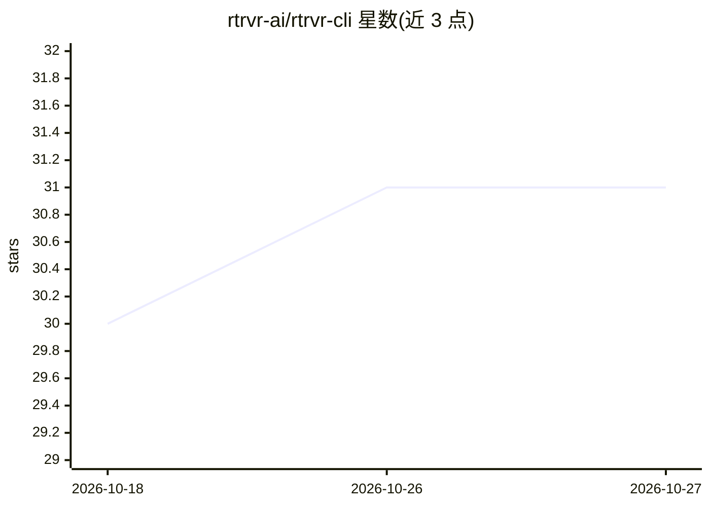

# rtrvr-ai/rtrvr-cli

⭐ 31 · TypeScript · Apache-2.0 · 推送 2026-10-23 · [GitHub](https://github.com/rtrvr-ai/rtrvr-cli) · [官网](https://www.rtrvr.ai/) · 组织维护

**网页自动化与抓取的 CLI/SDK，供 AI agent 与人类调用**

面向 AI agent 与人类的浏览器自动化工具，以 CLI 与 TypeScript SDK 形式提供。支持三种执行模式：云端运行 agent 与抓取页面、路由到本地浏览器扩展处理已认证会话、auto 模式自动切换。可运行自然语言描述的多步网页任务、按 JSON schema 生成结构化输出、管理可复用技能模板，并可配置为 MCP server 供 Claude Code、Cursor 等 AI 编码工具直接调用浏览器自动化工具。需认证（API key 或 OAuth），云端功能按 credit 计费。

## 筛选速览

| 维度 | 判定 | 备注 |
|---|---|---|
| AI 角色 | `ai-native` | 本体是模型或模型工具 |
| 许可风险 | `permissive` | Apache-2.0 |
| 部署形态 | `library` | 以包/库形式分发 |
| 模型依赖 | — | README 未给出锁定关系 |
| 硬件要求 | — | 无带数字的原话,不猜 |
| 安装摩擦 | `low` | 无编译、无系统依赖或容器化 |
| 成熟度 | — | 结构信号不足 |

## 能力要点

- cloud/extension/auto 三种执行模式，auto 自动回退路由
- 作为原生 MCP server 向 AI 编码工具暴露 8 个浏览器自动化工具
- 支持 JSON schema 结构化输出与 SSE 实时进度流
- 云端调用附带 trajectoryId 与 Idempotency-Key 幂等重试

## 适用场景

- 让 AI 编码工具通过 MCP 直接操作浏览器完成网页任务
- 在 CLI 中用一句话驱动多步网页自动化并提取结构化数据
- 利用本地浏览器扩展抓取需登录态的页面数据

## 场景标签

`浏览器自动化` `网页抓取` · 领域:效率与自动化

## 证据(README 行号)

> L7: Browser automation for AI agents and humans. One CLI, three execution modes: cloud, local browser extension, or auto
> L66: Run an AI agent task with smart routing.
> L182: rtrvr works as a native MCP server, giving AI coding tools (Claude Code, Cursor, etc.) direct access to browser au

## 星数曲线

2026-10-18 30 → 2026-10-27 31（+1）

---
*卡片 v1 · prompt 1.4 · 生成 2026-10-26 · 置信度 high · 依据 README sha `16f15a5aac99` · [字段定义](../../DATASET.md)*
