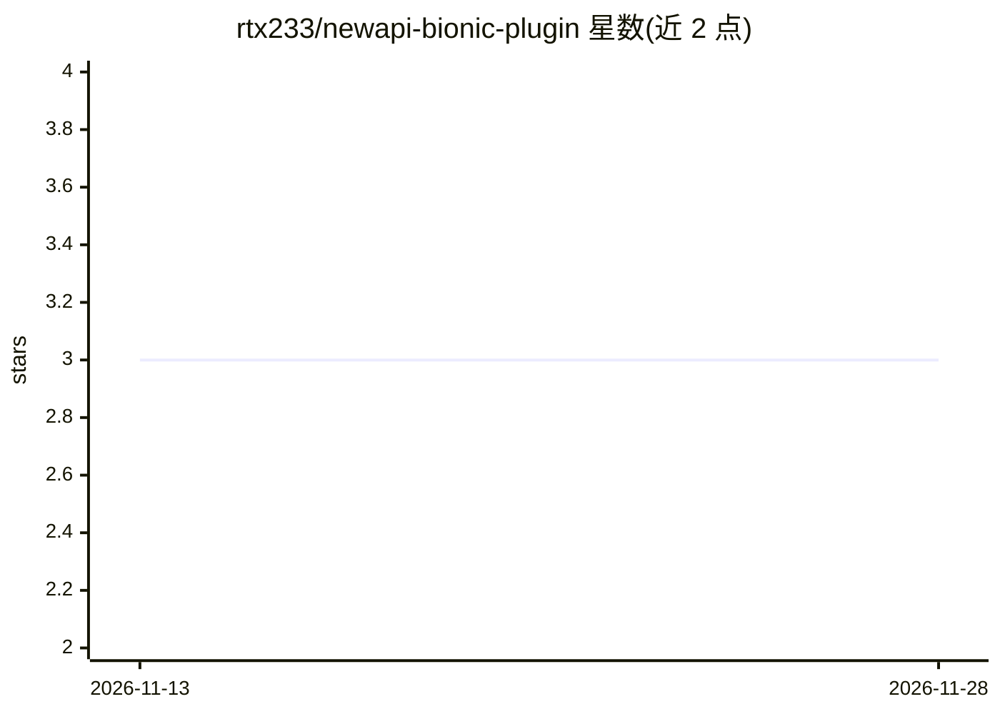

# rtx233/newapi-bionic-plugin

⭐ 3 · JavaScript · MIT · 推送 2026-11-13 · [GitHub](https://github.com/rtx233/newapi-bionic-plugin) · 个人维护 · 中文 README

**把 Bionic 桌面应用的本地模型接入 New API 网关的插件**

New API 的社区插件，将 Bionic 桌面应用（Element Labs 出品，基于 LM Studio）里运行的本地模型接入 New API 网关。Bionic 原生支持 OpenAI、Responses 和 Anthropic Messages 协议，插件直接转发请求并按返回 token 计费；Gemini 请求先转换为对话补全。提供模型列表拉取（语言/向量/已加载过滤）、空闲模型自动卸载、定时健康检查并在 Bionic 不可达时自动禁用渠道密钥。通过插件市场或 URL 导入安装，要求 New API v1.0.0-rc.50 以上。

## 筛选速览

| 维度 | 判定 | 备注 |
|---|---|---|
| AI 角色 | `ai-ecosystem` | LLM/agent 周边工具 |
| 许可风险 | `permissive` | MIT |
| 部署形态 | `None` |  |
| 模型依赖 | — | README 未给出锁定关系 |
| 硬件要求 | — | 无带数字的原话,不猜 |
| 安装摩擦 | `low` | 无编译、无系统依赖或容器化 |
| 成熟度 | — | 结构信号不足 |

## 能力要点

- 转发 OpenAI、Responses、Anthropic Messages、Gemini、补全与向量共 7 类接口
- 按需加载的模型空闲后自动释放内存（空闲卸载时间）
- 定时健康检查：Bionic 不可达时自动禁用密钥，恢复后自动启用
- 从 Bionic 获取模型列表并可按语言/向量/已加载过滤

## 适用场景

- 在 New API 网关中统一管理 Bionic 本地模型渠道
- 让局域网内多台机器通过隧道共用一台电脑上的 Bionic 模型
- 按 token 对本地模型的调用进行计费

## 场景标签

 · 领域:LLM 基础设施/网关插件

## 证据(README 行号)

> L7: 把 Bionic 桌面应用（Element Labs 出品，基于 LM Studio）里运行的模型接入 New API。Bionic 本地服务原生支持 OpenAI、OpenAI Responses 和 Anthropic Mess
> L15: 需要 New API v1.0.0-rc.50 或更高版本。
> L19: - 在网关「插件 → 插件市场」的社区插件里搜索 Bionic 安装，或者把插件码粘贴到「插件码」框里。

## 星数曲线

2026-11-13 3 → 2026-11-28 3（+0）

---
*卡片 v1 · prompt 1.4 · 生成 2026-11-21 · 置信度 high · 依据 README sha `4753e2f21019` · [字段定义](../../DATASET.md)*
