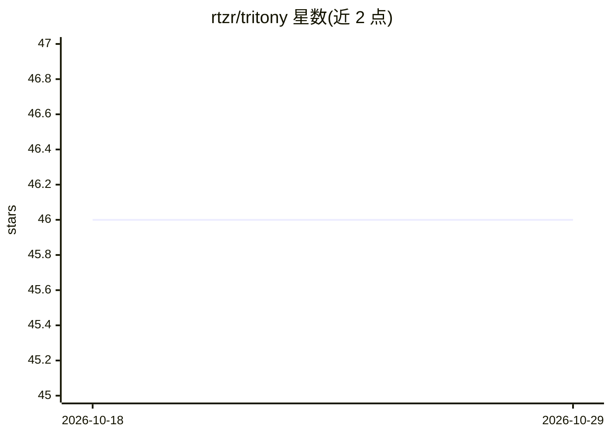

# rtzr/tritony

⭐ 46 · Python · BSD-3-Clause · 推送 2026-10-01 · [GitHub](https://github.com/rtzr/tritony) · 组织维护

**简化 Triton Inference Server 客户端配置的 Python 库**

面向使用 NVIDIA Triton Inference Server 的开发者：官方示例配置繁琐，本库以极少代码完成连接配置，仅需 host:port 与 model_name 即可生成请求；基于 asyncio.Queue 生成异步请求，支持 async tritonclient 与简单模型切换，异步任务数可通过 TRITON_ASYNC_TASKS/ASYNC_TASKS 环境变量配置，默认为 4。以 pip 包形式从 PyPI 安装，依赖 tritonclient[all]，并附带示例脚本与 pytest 测试。

## 筛选速览

| 维度 | 判定 | 备注 |
|---|---|---|
| AI 角色 | `ai-ecosystem` | LLM/agent 周边工具 |
| 许可风险 | `permissive` | BSD-3-Clause |
| 部署形态 | `library` | 以包/库形式分发 |
| 模型依赖 | — | README 未给出锁定关系 |
| 硬件要求 | — | 无带数字的原话,不猜 |
| 安装摩擦 | `low` | 无编译、无系统依赖或容器化 |
| 成熟度 | — | 结构信号不足 |

## 能力要点

- 仅需 host:port 与 model_name 即可完成配置
- 基于 asyncio.Queue 生成异步请求
- 支持 async tritonclient 与简单模型切换

## 适用场景

- 以更少代码接入 Triton Inference Server 做推理请求
- 需要异步批量发送推理请求的场景
- 在多个模型间快速切换测试

## 场景标签

`推理引擎` · 领域:训练与推理

## 证据(README 行号)

> L24: - [x] Simple configuration. Only `$host:$port` and `$model_name` are required.
> L27: - [x] Support async tritonclient

## 星数曲线

2026-10-18 46 → 2026-10-29 46（+0）

---
*卡片 v1 · prompt 1.4 · 生成 2026-10-25 · 置信度 high · 依据 README sha `314d9b609707` · [字段定义](../../DATASET.md)*
