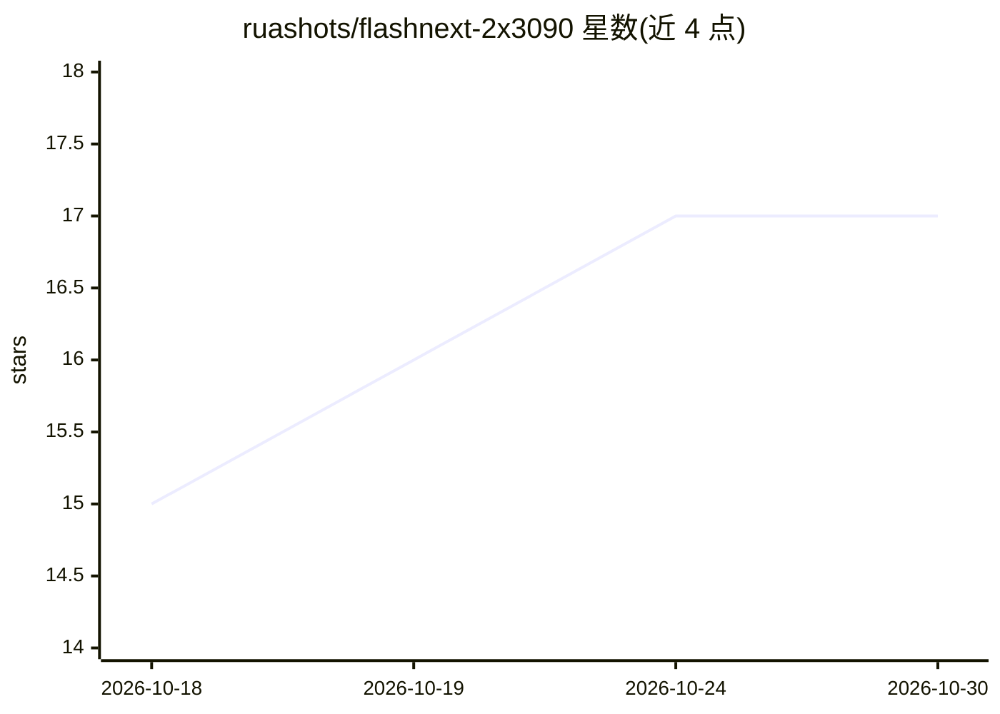

# ruashots/flashnext-2x3090

⭐ 17 · Python · MIT · 推送 2026-10-12 · [GitHub](https://github.com/ruashots/flashnext-2x3090) · 个人维护

**个人推理服务器记录：Qwen3.8-Flash-Next 双 3090 运行与评测**

个人维护的推理服务器搭建与基准记录仓库：记录 Qwen3.8-Flash-Next（OrcaRouter 的 IQ4_XS 量化）经 Strata 引擎跑在两张 RTX 3090 上的配置与基准数据（生成速度、长上下文读取、GSM8K、大海捞针检索等），并按时间线记录从 llama.cpp、EXL3/TabbyAPI、vLLM fork 到 Strata 的方案演进过程。提供 setup 文件夹内的配置、服务文件、复现步骤与基准脚本。注意：仓库已声明迁移至三卡版本仓库，本仓库保留为双卡时期的记录。

## 筛选速览

| 维度 | 判定 | 备注 |
|---|---|---|
| AI 角色 | `ai-knowledge` | 知识聚合/清单类 |
| 许可风险 | `permissive` | MIT |
| 部署形态 | `None` |  |
| 模型依赖 | — | README 未给出锁定关系 |
| 硬件要求 | — | 无带数字的原话,不猜 |
| 安装摩擦 | `high` | 编译与系统依赖俱全 |
| 成熟度 | — | 结构信号不足 |

## 能力要点

- 262K/512K/1M 三种上下文配置可切换，含服务文件与复现步骤
- 速度、检索、GSM8K、多请求并发等基准脚本与原始结果数据（raw/）
- 记录 llama.cpp→EXL3→vLLM fork→Strata 的方案演进与各阶段数据

## 适用场景

- 复现双 RTX 3090 上运行 Qwen3.8-Flash-Next 的完整搭建
- 查阅不同推理方案在同一硬件上的速度对比数据
- 了解长上下文（至 1M）本地推理的配置取舍

## 场景标签

`模型评测` `推理引擎` · 领域:评测与运维

## 证据(README 行号)

> L3: > **This repo moved.** I upgraded the inference server to three RTX 3090s and 128 GB of RAM, so what I run now, and 
> L5: Qwen3.8-Flash-Next on two RTX 3090s. While it ran on two cards, this page showed the current setup on top, and each 
> L90: ## What's in the repo

## 星数曲线

2026-10-18 15 → 2026-10-30 17（+2）

---
*卡片 v1 · prompt 1.4 · 生成 2026-10-29 · 置信度 high · 依据 README sha `82962583965a` · [字段定义](../../DATASET.md)*
