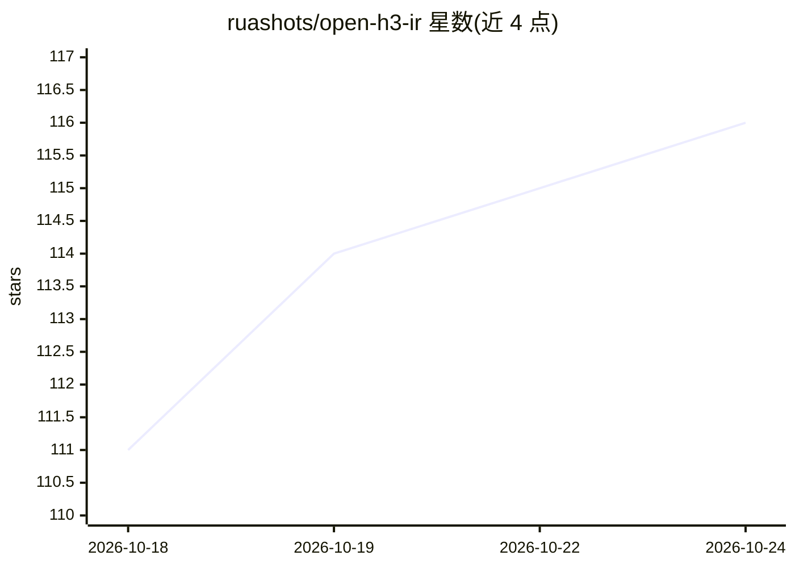

# ruashots/open-h3-ir

⭐ 116 · Python · Apache-2.0 · 推送 2026-08-23 · [GitHub](https://github.com/ruashots/open-h3-ir) · 个人维护

**把自然语言提示编译为 MiniMax H3 结构化视频简报的本地工具**

MiniMax H3 的开源本地 Context-IR 实现：调用用户已有的 OpenAI 兼容端点（Ollama、llama.cpp server、LM Studio、vLLM 或托管 API），把一段自然语言提示与参考图片编译为 H3 需要的结构化文档（固定顺序的命名节、编号图片标签、对齐帧网格的剪辑时间），并通过校验器检查。提供 ComfyUI 节点、HTTP API 与 CLI 三种使用方式，含创意程度档位与导演风格段落机制。编译器自身无需 GPU，需端点模型支持图像输入。作者声明这是年轻项目，可能变更。

## 筛选速览

| 维度 | 判定 | 备注 |
|---|---|---|
| AI 角色 | `ai-ecosystem` | LLM/agent 周边工具 |
| 许可风险 | `permissive` | Apache-2.0 |
| 部署形态 | `library` | 以包/库形式分发 |
| 模型依赖 | local-ok | 支持本地模型 |
| 硬件要求 | — | 无带数字的原话,不猜 |
| 安装摩擦 | `medium` | 含编译或系统依赖之一 |
| 成熟度 | `idea` | |

## 能力要点

- 调用任意 OpenAI 兼容端点生成结构化 H3 Context-IR 简报
- ComfyUI 四节点 / HTTP API / CLI 三种使用途径
- 创意程度四档与导演风格段落（名称不发送给模型）
- 三层响应（presentation/plan/ir）与校验器拒绝不合规简报

## 适用场景

- 把随手写的提示转成 H3 能准确执行的结构化视频简报
- 在 ComfyUI 工作流里直接编译 H3 提示
- 通过 HTTP API 从自己的应用调用简报编译服务

## 场景标签

`提示工程` `视频生成` · 领域:Agent 开发

## 证据(README 行号)

> L23: and that the way to get one is to call their hosted service. This is an independent open implementation of
> L26: It talks to any OpenAI-compatible endpoint you already have running: Ollama, llama.cpp's server, LM

## 星数曲线

2026-10-18 111 → 2026-10-24 116（+5）

---
*卡片 v1 · prompt 1.4 · 生成 2026-10-23 · 置信度 high · 依据 README sha `1dc4cc62e391` · [字段定义](../../DATASET.md)*
