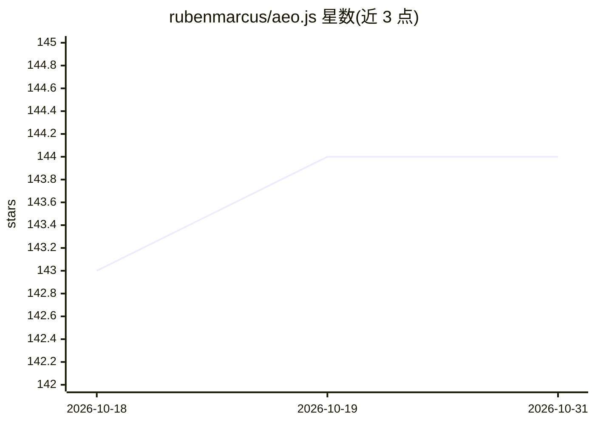

# rubenmarcus/aeo.js

⭐ 144 · TypeScript · 推送 2026-10-26 · [GitHub](https://github.com/rubenmarcus/aeo.js) · [官网](https://aeojs.org) · 个人维护

**面向 AI 搜索引擎的站点优化工具：生成 llms.txt 等发现性文件**

npm 包 aeo.js，为网站生成供 AI 爬虫与回答引擎读取的 robots.txt、llms.txt、sitemap、JSON-LD 等文件，并提供 0-100 GEO 就绪度评分、23 种 AI 爬虫访问矩阵与内容可引用度检查（CLI 与浏览器版）。支持 Astro/Next.js/Vite/Nuxt/Remix/SvelteKit/Angular/Webpack 等框架插件与独立 CLI，内置 Human/AI 切换 widget（React/Vue 组件），另提供 MCP server 供 Claude Code、Cursor 等客户端对话式审计站点。

## 筛选速览

| 维度 | 判定 | 备注 |
|---|---|---|
| AI 角色 | `ai-ecosystem` | LLM/agent 周边工具 |
| 许可风险 | `none` | — |
| 部署形态 | `library` | 以包/库形式分发 |
| 模型依赖 | — | README 未给出锁定关系 |
| 硬件要求 | — | 无带数字的原话,不猜 |
| 安装摩擦 | `low` | 无编译、无系统依赖或容器化 |
| 成熟度 | — | 结构信号不足 |

## 能力要点

- 生成 robots.txt、llms.txt、sitemap、JSON-LD 等 AEO 文件集
- 0-100 GEO 评分、23 种 AI 爬虫访问矩阵与内容可引用度检查
- 覆盖 9 种构建框架的插件与独立 CLI（npx aeo.js init/generate/check）
- 提供 MCP server 与 React/Vue Human/AI 切换 widget

## 适用场景

- 让我的网站更容易被 ChatGPT、Claude、Perplexity 等 AI 搜索引用
- 在建站流程中自动生成 llms.txt 与结构化数据
- 用 CLI 快速检查任意已部署站点的 AI 可见度
- 通过 Claude Code/Cursor 对话式审计并修复站点 AEO 问题

## 场景标签

 · 领域:Web 开发/SEO 工具

## 证据(README 行号)

> L2:  Answer Engine Optimization for the modern web. Make your site discoverable by ChatGPT, Claude, Perplexity, and ever
> L244: ├── llms.txt          # Short LLM-readable summary

## 星数曲线

2026-10-18 143 → 2026-10-31 144（+1）

---
*卡片 v1 · prompt 1.4 · 生成 2026-10-23 · 置信度 high · 依据 README sha `f9101f67e470` · [字段定义](../../DATASET.md)*
