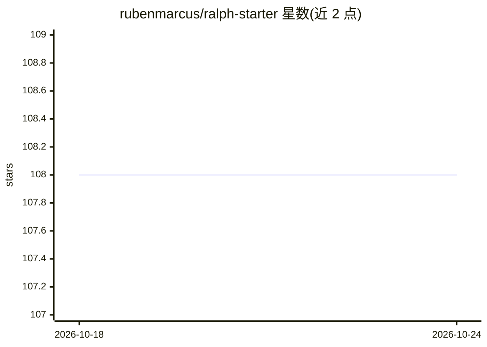

# rubenmarcus/ralph-starter

⭐ 108 · TypeScript · MIT · 推送 2026-10-21 · [GitHub](https://github.com/rubenmarcus/ralph-starter) · [官网](https://ralphstarter.ai) · 个人维护

**编排自主 AI 编程循环的 CLI：从 GitHub/Linear/Notion/Figma 拉取需求驱动编码 agent**

Ralph Wiggum 循环模式的生产化实现：从 GitHub issues、Linear 工单、Notion 文档、Figma 设计稿、URL 或本地文件拉取规格，随后在循环中调用外部编码 agent（Claude Code、Cursor、Copilot、Gemini CLI 等 8+ 种）迭代构建直至任务完成。提供断路器（连续失败自动停止）、每迭代测试/lint/build 回压验证、成本与 token 估算、限流、git 自动提交/推送/建 PR，并可启动为 MCP Server 供 Claude Desktop 调用。内部 LLM 调用支持 Anthropic/OpenAI/OpenRouter。npm 全局安装。

## 筛选速览

| 维度 | 判定 | 备注 |
|---|---|---|
| AI 角色 | `ai-ecosystem` | LLM/agent 周边工具 |
| 许可风险 | `permissive` | MIT |
| 部署形态 | `library` | 以包/库形式分发 |
| 模型依赖 | — | README 未给出锁定关系 |
| 硬件要求 | — | 无带数字的原话,不猜 |
| 安装摩擦 | `low` | 无编译、无系统依赖或容器化 |
| 成熟度 | — | 结构信号不足 |

## 能力要点

- 从 GitHub/Linear/Notion/Figma/URL/文件拉取规格驱动自主编程循环
- 支持 8+ 编码 agent 与 16+ 工作流预设
- 断路器、回压验证、限流与成本跟踪等安全控制
- 可作为 MCP Server 供 Claude Desktop 等 MCP 客户端调用

## 适用场景

- 把 GitHub issue 或 Linear 工单自动转化为提交与 PR
- 非开发者通过交互式向导用自然语言创建项目
- 在循环中自动跑测试/lint/build 并把失败反馈给 agent 修复

## 场景标签

`编码 Agent` · 领域:编码与开发

## 证据(README 行号)

> L26: **ralph-starter** brings the Ralph Wiggum technique to production. It **connects to your existing workflow** — pull
> L86: **ralph-starter** is the production-grade Ralph Wiggum implementation — it adds integrations, safety controls (circ

## 星数曲线

2026-10-18 108 → 2026-10-24 108（+0）

---
*卡片 v1 · prompt 1.4 · 生成 2026-10-23 · 置信度 high · 依据 README sha `583335ba9936` · [字段定义](../../DATASET.md)*
