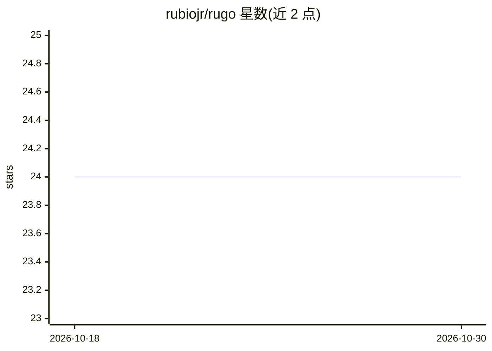

# rubiojr/rugo

⭐ 24 · Go · MIT · 推送 2026-10-29 · [GitHub](https://github.com/rubiojr/rugo) · [官网](https://rugo-lang.dev) · 个人维护

**Ruby 语法编译为 Go 原生二进制的编程语言**

一种 Ruby 风格语法的编程语言，编译为原生 Go 二进制，无需运行时。功能包括可选类型注解（生成带类型的 Go 签名）、未知命令回退为 shell 执行、命名空间模块、直接调用 Go 标准库、spawn 并发、内联测试（rats）、Linux Landlock 沙箱，以及实验性 Qt 声明式 UI 模块。README 自称 agent product 与实验性项目（vibecoded，部分或全部代码由 AI 编写），维护者声明非生产工具。

## 筛选速览

| 维度 | 判定 | 备注 |
|---|---|---|
| AI 角色 | `ai-ecosystem` | LLM/agent 周边工具 |
| 许可风险 | `permissive` | MIT |
| 部署形态 | `library` | 以包/库形式分发 |
| 模型依赖 | — | README 未给出锁定关系 |
| 硬件要求 | — | 无带数字的原话,不猜 |
| 安装摩擦 | `low` | 无编译、无系统依赖或容器化 |
| 成熟度 | `idea` | |

## 能力要点

- Ruby 风格语法编译为原生 Go 二进制，无需运行时
- 未知命令回退为 shell 命令执行（类 Bash）
- 可选类型注解生成带类型的 Go 签名
- Linux Landlock 内核沙箱（可选，无需 root）

## 适用场景

- 用 Ruby 语法编写可编译为原生二进制的小型程序
- 在脚本中混用 Ruby 语法与 shell 命令、Go 标准库调用
- 通过 Landlock 沙箱限制脚本的文件系统与网络访问

## 场景标签

 · 领域:编程语言/开发工具

## 证据(README 行号)

> L5:  Vibecoded: some or all of this code was written by AI and accepted on vibes
> L20: > Rugo is an agent product.

## 星数曲线

2026-10-18 24 → 2026-10-30 24（+0）

---
*卡片 v1 · prompt 1.4 · 生成 2026-10-27 · 置信度 mid · 依据 README sha `7b3ce78fcb83` · [字段定义](../../DATASET.md)*
