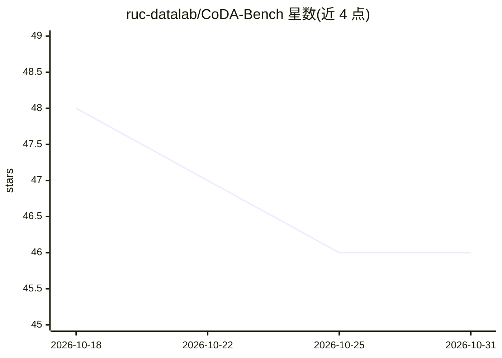

# ruc-datalab/CoDA-Bench

⭐ 46 · Python · MIT · 推送 2026-09-29 · [GitHub](https://github.com/ruc-datalab/CoDA-Bench) · [官网](https://coda-bench.github.io/) · 组织维护 · 中文 README

**评测代码智能体数据密集任务能力的基准（1,009 任务）**

中国人民大学团队发布的评测基准（ICML 2026 论文），用于测试 AI 代码智能体在数据密集分析任务上的表现：给定自然语言问题和包含数百个数据文件的 Linux 沙箱，智能体需自主发现相关数据、编写代码并给出答案。数据来自 199 个 Kaggle 数据集，共 1,009 个任务（含 119 个困难子集），总量约 66.45 GB。提供 Docker 隔离评测环境（禁止网络、限制资源、防止访问答案），支持手动评测路径，并附 GPT-5.5 等模型的基线榜单。限制：需下载大规模数据集，此前的评测分数对 v1.0.1 修正版数据集的适用性未经验证。

## 筛选速览

| 维度 | 判定 | 备注 |
|---|---|---|
| AI 角色 | `ai-ecosystem` | LLM/agent 周边工具 |
| 许可风险 | `permissive` | MIT |
| 部署形态 | `library` | 以包/库形式分发 |
| 模型依赖 | — | README 未给出锁定关系 |
| 硬件要求 | — | 无带数字的原话,不猜 |
| 安装摩擦 | `low` | 无编译、无系统依赖或容器化 |
| 成熟度 | — | 结构信号不足 |

## 能力要点

- 1,009 个任务 / 49 个社区 / 199 个 Kaggle 数据集，约 66.45 GB
- 要求智能体在约 3,413 个文件中自主发现数据并生成分析代码
- Docker 隔离评测：网络受限、资源限制、答案不可访问
- 提供 EA（执行准确率）与 DA（发现准确率）双指标及基线榜单

## 适用场景

- 评测代码智能体在真实数据文件环境中的分析与编码能力
- 对比不同 agent 框架（OpenHands、Codex CLI、Claude Code 等）的表现
- 作为数据科学方向的智能体研究基准

## 场景标签

`模型评测` `数据分析` · 领域:效率与自动化

## 证据(README 行号)

> L21: CoDA-Bench (Code and Data-intensive Benchmark) is a benchmark for evaluating AI agents on data-intensive analytical
> L42: |**Total Tasks**|1,009 (full) / 119 (hard subset)|
> L15: > **Authors**: **Yuxin Zhang, Ju Fan, Meihao Fan, Shaolei Zhang*, Xiaoyong Du**

## 星数曲线

2026-10-18 48 → 2026-10-31 46（-2）

---
*卡片 v1 · prompt 1.4 · 生成 2026-10-25 · 置信度 high · 依据 README sha `1180bb060c1e` · [字段定义](../../DATASET.md)*
