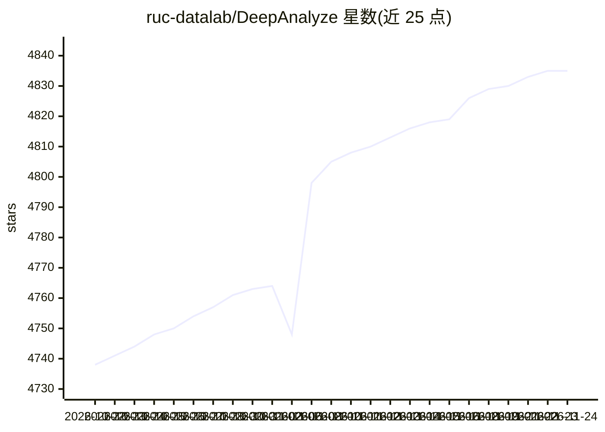

# ruc-datalab/DeepAnalyze

⭐ 4,835 · Python · MIT · 推送 2026-11-02 · [GitHub](https://github.com/ruc-datalab/DeepAnalyze) · [官网](https://ruc-deepanalyze.github.io) · 组织维护 · 中文 README

**自主完成数据科学任务并生成分析报告的 8B agentic LLM**

由中国人民大学等机构发布的开源数据科学模型（DeepAnalyze-8B），可在无人工干预下完成数据准备、分析、建模、可视化与报告生成。通过 vLLM 本地部署模型，或申请官方 API key 使用；交互方式包括 WebUI、WebUI v2（新增 HeyWhale API key 与 Docker 沙箱代码执行）、JupyterUI 与 CLI。支持数据库、CSV、Excel、JSON、XML、YAML、TXT、Markdown 等结构化与半结构化数据源，输出可渲染为 PDF 的研究报告。训练相关依赖在单独目录中另行给出。

## 筛选速览

| 维度 | 判定 | 备注 |
|---|---|---|
| AI 角色 | `ai-native` | 本体是模型或模型工具 |
| 许可风险 | `permissive` | MIT |
| 部署形态 | `library` | 以包/库形式分发 |
| 模型依赖 | local-ok | 支持本地模型 |
| 硬件要求 | `gpu-8g` | |
| 安装摩擦 | `low` | 无编译、无系统依赖或容器化 |
| 成熟度 | `idea` | |

## 能力要点

- 模型、代码、训练数据与 demo 全部开源（L22）
- 自主执行数据准备、分析、建模、可视化、报告生成全流程（L20）
- 提供 WebUI/WebUI v2/JupyterUI/CLI 四种交互方式
- 提供显存配置表与量化脚本（16GB/24GB/40GB/80GB 档位）

## 适用场景

- 上传本地数据自动生成分析报告
- 对 CSV/Excel/数据库等多源数据做开放式研究
- 本地部署私有数据分析助手
- 通过 API 接入自有数据分析流程

## 场景标签

`数据分析` · 领域:效率与自动化

## 证据(README 行号)

> L19: **DeepAnalyze** is the first agentic LLM for autonomous data science. It can autonomously complete a wide range of 
> L118: - Deploy DeepAnalyze-8B via vllm: `vllm serve DeepAnalyze-8B`
> L265: - Install packages: `torch`, `transformers`, `vllm>=0.8.5`

## 星数曲线

2026-10-22 4,738 → 2026-11-24 4,835（+97）

---
*卡片 v1 · prompt 1.4 · 生成 2026-11-22 · 置信度 high · 依据 README sha `e9b044b7a97f` · [字段定义](../../DATASET.md)*
