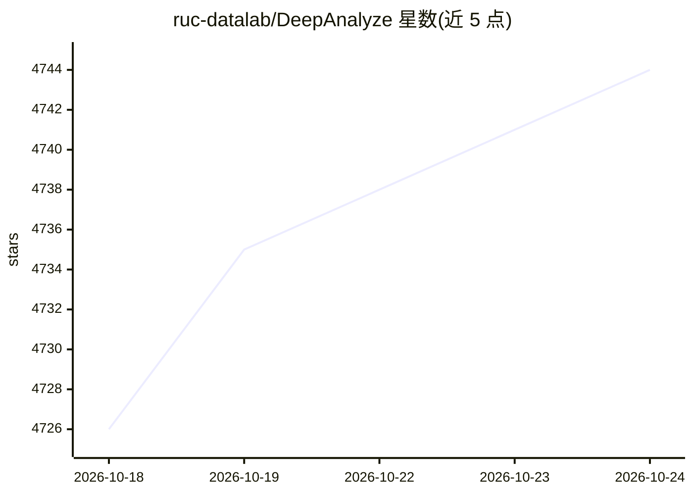

# ruc-datalab/DeepAnalyze

⭐ 4,744 · Python · MIT · 推送 2026-10-13 · [GitHub](https://github.com/ruc-datalab/DeepAnalyze) · [官网](https://ruc-deepanalyze.github.io) · 组织维护 · 中文 README

**自主数据科学的智能体 LLM：自动完成数据分析并生成报告**

中国人民大学等机构发布的开源智能体大模型（DeepAnalyze-8B），可自主完成数据科学全流程任务：数据准备、分析、建模、可视化与报告生成，支持对数据库、CSV、Excel、JSON、TXT 等多类数据源的开放式深度研究并产出研究报告。模型、代码、训练数据均开源；通过 vLLM 部署，提供 WebUI、WebUI v2、JupyterUI、CLI 与 OpenAI 风格 API 多种交互方式，另提供 API Key 申请渠道。附 16GB-80GB 显存配置建议与量化方案。

## 筛选速览

| 维度 | 判定 | 备注 |
|---|---|---|
| AI 角色 | `ai-native` | 本体是模型或模型工具 |
| 许可风险 | `permissive` | MIT |
| 部署形态 | `library` | 以包/库形式分发 |
| 模型依赖 | local-ok | 支持本地模型 |
| 硬件要求 | `gpu-8g` | |
| 安装摩擦 | `low` | 无编译、无系统依赖或容器化 |
| 成熟度 | — | 结构信号不足 |

## 能力要点

- 自主完成数据准备、分析、建模、可视化与报告生成的全流程任务
- 支持结构化、半结构化与非结构化多类数据源的开放式深度研究
- 模型、代码、训练数据与 Demo 均开源，基于 DeepSeek-R1-0528-Qwen3-8B 训练
- 提供 WebUI / JupyterUI / CLI / OpenAI 风格 API 多种使用方式，vLLM 部署并给出量化配置表

## 适用场景

- 上传数据后让模型自动完成分析并生成可导出 PDF 的研究报告
- 本地部署私有数据分析助手，无需外部工作流或闭源 API
- 基于开源训练数据与脚本微调出自己的数据分析智能体模型

## 场景标签

`数据分析` `微调` `科研工具` · 领域:效率与自动化

## 证据(README 行号)

> L20: **DeepAnalyze** is the first agentic LLM for autonomous data science. It can autonomously complete a wide range of 
> L22: - 🔍 **Open-ended data research**: Conduct deep research on diverse data sources, including structured data (Databas
> L23: - 📊 **Fully open-source**: The model, code, training data, and demo of DeepAnalyze are all open-sourced, allowing y

## 星数曲线

2026-10-18 4,726 → 2026-10-24 4,744（+18）

---
*卡片 v1 · prompt 1.4 · 生成 2026-10-20 · 置信度 mid · 依据 README sha `d3f3910009b4` · [字段定义](../../DATASET.md)*
