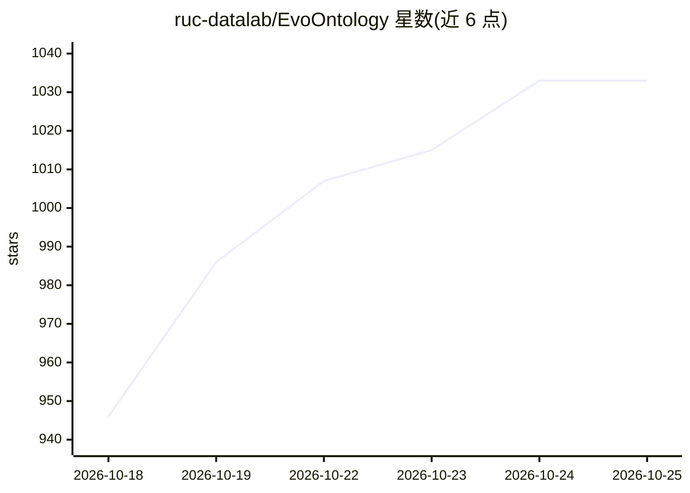

# ruc-datalab/EvoOntology

⭐ 1,039 · Python · MIT · 推送 2026-10-09 · [GitHub](https://github.com/ruc-datalab/EvoOntology) · 组织维护 · 中文 README

**为数据 Agent 构建并持续进化的本体层 MCP 插件**

人民大学团队开发的自进化本体层：从异构表、文件与数据库中自动构建三层结构（Content/Schema/Tool）的本体层，通过 MCP 工具（browse_semantics、resolve_semantics）按需供 Claude Code、Codex 等 Agent 查询；并基于交互轨迹诊断、验证后以门控版本方式持续演化本体。构建/演化在评估通过后才发布新版本，SQLite 支持只读任务重放。以 Claude Code 与 Codex 插件形式安装，无需克隆仓库或 pip 安装。

## 筛选速览

| 维度 | 判定 | 备注 |
|---|---|---|
| AI 角色 | `ai-ecosystem` | LLM/agent 周边工具 |
| 许可风险 | `permissive` | MIT |
| 部署形态 | `library` | 以包/库形式分发 |
| 模型依赖 | — | README 未给出锁定关系 |
| 硬件要求 | — | 无带数字的原话,不猜 |
| 安装摩擦 | `low` | 无编译、无系统依赖或容器化 |
| 成熟度 | — | 结构信号不足 |

## 能力要点

- 从工作负载与底层数据自动构建三层本体（Content/Schema/Tool）
- 通过 MCP 工具按需检索语义，而非整体注入上下文
- 基于执行轨迹做局部更新，Candidate 需配对评估胜过 Parent 才发布
- 以 Claude Code / Codex 插件形式分发，Build/Evolve/Explore 工作流

## 适用场景

- 让数据分析 Agent 复用已验证的业务语义，减少重复探索
- 在数据与负载变化时维护不过时的语义层
- 在 BIRD、DDR-10K、InsightBench 等评测环境做数据 Agent 实验

## 场景标签

`数据分析` · 领域:效率与自动化

## 证据(README 行号)

> L19: EvoOntology is the first self-evolving ontology layer for data agents, aiming to bridge the **agent-data gap** over
> L20: - 🔌 Universal Agent Plugin as MCP: Seamlessly integrates with Claude Code, Codex, and other AI agents.
> L52: |**Active access**|Retrieve only the semantics needed for the current step through MCP tools instead of injecting t

## 星数曲线

2026-10-18 946 → 2026-10-25 1,033（+87）

---
*卡片 v1 · prompt 1.4 · 生成 2026-10-21 · 置信度 mid · 依据 README sha `c45dccc4d857` · [字段定义](../../DATASET.md)*
