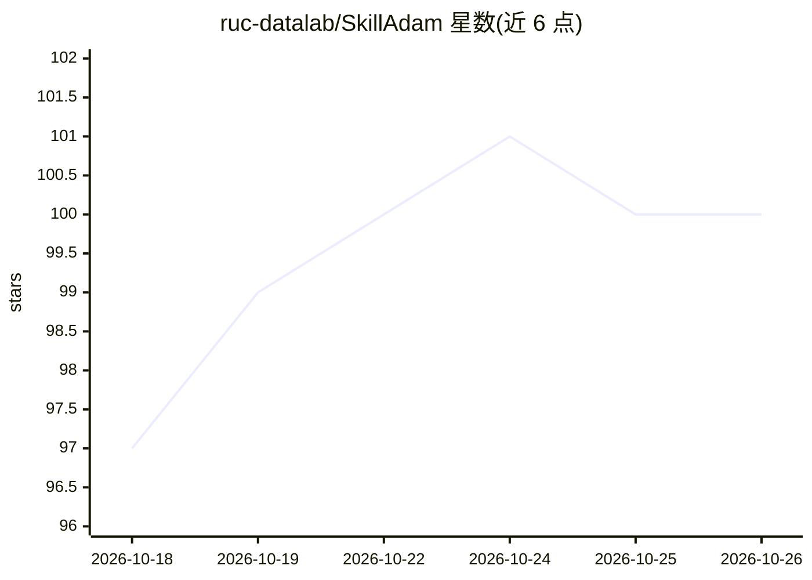

# ruc-datalab/SkillAdam

⭐ 100 · Python · NOASSERTION · 推送 2026-09-26 · [GitHub](https://github.com/ruc-datalab/SkillAdam) · 组织维护 · 中文 README

**自动测试并改进 AI agent 的 SKILL.md 技能文件的工具**

面向 Codex、Claude Code、Cursor Agent、GitHub Copilot 四个平台的 agent 技能优化插件：给定一个已有 SKILL.md 和改进目标，它生成相关任务与评分规则，测试当前技能，提出修改并在通过验证后才更新文件。利用优化记忆从历史修订中学习，可逐条审阅或自动采纳编辑，支持中断恢复。默认使用平台已有登录，无需本地 GPU、Docker 或独立 API key；一次只优化一个 SKILL.md。由中国人民大学数据实验室与腾讯相关团队维护，附 arXiv 论文，MIT 许可。

## 筛选速览

| 维度 | 判定 | 备注 |
|---|---|---|
| AI 角色 | `ai-ecosystem` | LLM/agent 周边工具 |
| 许可风险 | `none` | NOASSERTION |
| 部署形态 | `None` |  |
| 模型依赖 | — | README 未给出锁定关系 |
| 硬件要求 | — | 无带数字的原话,不猜 |
| 安装摩擦 | `low` | 无编译、无系统依赖或容器化 |
| 成熟度 | — | 结构信号不足 |

## 能力要点

- 在相关任务上测试 SKILL.md 并验证修订后才更新文件
- 支持 Codex / Claude Code / Cursor Agent / GitHub Copilot 四平台集成
- 优化记忆从先前修订中学习并修正重复问题
- 默认复用平台账号登录，无需本地 GPU、Docker 或独立模型 API key

## 适用场景

- 我在 Claude Code 里让 SkillAdam 把某个技能文件改得更符合我的工作流
- 针对技能反复出现的具体问题（如输出冗长）做定向优化
- 逐条审阅技能文件的修改建议再决定是否应用

## 场景标签

`提示工程` · 领域:Agent 开发

## 证据(README 行号)

> L11: **Give SkillAdam a skill and tell it what you want to improve.** It tests your `SKILL.md` on relevant tasks, learns
> L13: **Supported platforms: Codex · Claude Code · Cursor Agent · GitHub Copilot.**

## 星数曲线

2026-10-18 97 → 2026-10-26 100（+3）

---
*卡片 v1 · prompt 1.4 · 生成 2026-10-23 · 置信度 high · 依据 README sha `a24383b3b7e8` · [字段定义](../../DATASET.md)*
