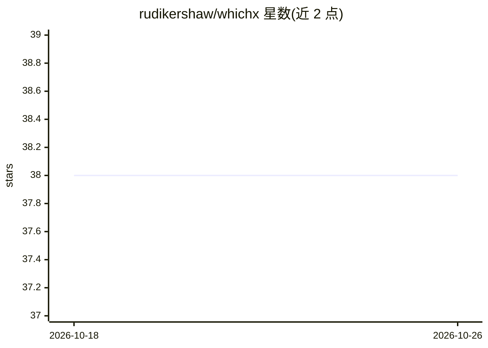

# rudikershaw/whichx

⭐ 38 · JavaScript · MIT · 推送 2026-09-13 · [GitHub](https://github.com/rudikershaw/whichx) · 个人维护

**JavaScript 朴素贝叶斯文本分类库，短文本归类**

用 JavaScript 编写的朴素贝叶斯分类器库，面向将短文本描述归入预设类别的场景：用户通过 addLabels 定义标签、addData 添加带标签的训练描述，再调用 classify 对新描述返回最可能标签。无任何外部依赖，API 为同步的 Node require 形式，提供在线演示示例（whichpet）。适合需要在 Node 环境中做轻量文本分类且不想引入依赖的开发者。

## 筛选速览

| 维度 | 判定 | 备注 |
|---|---|---|
| AI 角色 | `ai-native` | 本体是模型或模型工具 |
| 许可风险 | `permissive` | MIT |
| 部署形态 | `library` | 以包/库形式分发 |
| 模型依赖 | — | README 未给出锁定关系 |
| 硬件要求 | — | 无带数字的原话,不猜 |
| 安装摩擦 | `low` | 无编译、无系统依赖或容器化 |
| 成熟度 | — | 结构信号不足 |

## 能力要点

- 朴素贝叶斯算法实现短文本分类
- 零依赖的 JavaScript 库
- addLabels/addData/classify 三步式 API

## 适用场景

- 给商品或宠物等短描述自动打类别标签
- 在 Node 项目中嵌入轻量文本分类
- 教学演示朴素贝叶斯分类流程

## 场景标签

 · 领域:机器学习/NLP

## 证据(README 行号)

> L6: WhichX is a Naive Bayes' Classifier written in Javascript for classifying short text descriptions into categories. I
> L48: var pet = whichpet.classify("Its yellow and shoots lightning");

## 星数曲线

2026-10-18 38 → 2026-10-26 38（+0）

---
*卡片 v1 · prompt 1.4 · 生成 2026-10-25 · 置信度 high · 依据 README sha `0d0aa7460293` · [字段定义](../../DATASET.md)*
