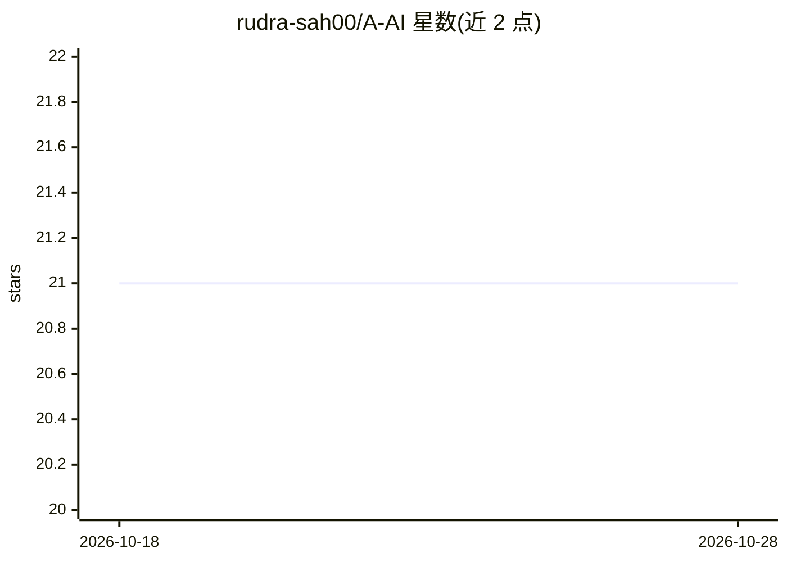

# rudra-sah00/A-AI

⭐ 21 · TypeScript · 推送 2026-01-09 · [GitHub](https://github.com/rudra-sah00/A-AI) · 个人维护

**Andhra Pradesh 政府黑客松的 AI 视频监控系统**

为 Andhra Pradesh Government Hackathon 开发的监控与安防系统：前端 Next.js/TypeScript，后端 Python/FastAPI，用 YOLO v5/v8 做实时目标检测、行为分析、人脸与车牌识别，支持多摄像头接入（RTSP/USB/ONVIF）、分级告警（邮件/SMS/应用内）、可视化仪表盘与角色权限管理。运行依赖 Node.js 18+、Python 3.8+、PostgreSQL、Redis；提供 Docker 与云端部署说明。

## 筛选速览

| 维度 | 判定 | 备注 |
|---|---|---|
| AI 角色 | `ai-native` | 本体是模型或模型工具 |
| 许可风险 | `none` | — |
| 部署形态 | `self-host` | docker 或自建部署 |
| 模型依赖 | — | README 未给出锁定关系 |
| 硬件要求 | — | 无带数字的原话,不猜 |
| 安装摩擦 | `low` | 无编译、无系统依赖或容器化 |
| 成熟度 | — | 结构信号不足 |

## 能力要点

- YOLO v5/v8 实时目标检测、行为分析与人脸/车牌识别
- 多摄像头接入（RTSP/USB/ONVIF/RTMP）与健康监测
- 分级告警与多渠道通知（邮件/SMS/推送/Webhook）
- Next.js 仪表盘：地图可视化、分析图表、角色权限管理

## 适用场景

- 接入 IP 摄像头做实时安全监控与告警
- 在安防指挥中心查看摄像头网络与事件分析
- 智慧城市场景下的公共场所异常行为检测

## 场景标签

`目标检测` `网络安全` `人脸识别` · 领域:学习与行业

## 证据(README 行号)

> L9: > **Andhra Pradesh Government Hackathon Project** - A comprehensive AI-powered surveillance and security monitoring 
> L54: - **YOLO Object Detection**: Real-time detection of people, vehicles, and objects
> L106: - **YOLO v5/v8**: Object detection and AI analysis

## 星数曲线

2026-10-18 21 → 2026-10-28 21（+0）

---
*卡片 v1 · prompt 1.4 · 生成 2026-10-28 · 置信度 high · 依据 README sha `ca7339241b0b` · [字段定义](../../DATASET.md)*
