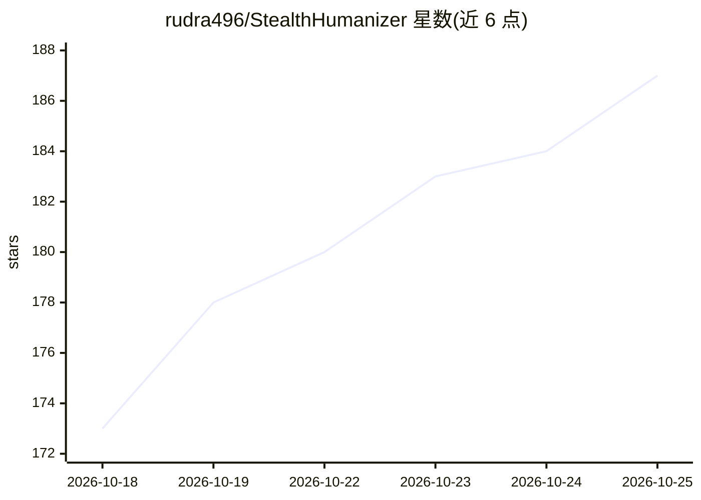

# rudra496/StealthHumanizer

⭐ 187 · TypeScript · MIT · 推送 2026-10-23 · [GitHub](https://github.com/rudra496/StealthHumanizer) · [官网](https://stealthhumanizer.vercel.app/) · 个人维护

**面向学生与写作者的开源 AI 文本人性化改写工具**

将 AI 生成文本改写为更接近人类写作的 Web 应用与 CLI：4 层流水线（LLM 改写、500+ 同义词替换等后处理、可选多模型链、最终润色），支持 35 个 AI 提供商（Gemini/OpenAI/Claude/Ollama/vLLM 等）、4 档改写强度、6 种写作风格、16+ 种语言。内置 12 指标本地 AI 检测评分与热力图，可选 PDF/DOCX 上传和批量处理。托管版走维护者自训 BART 模型与 gemma3:4b 自动路由，无需 API key；自部署需 Node 环境与各家 API key，API key 仅存浏览器本地。

## 筛选速览

| 维度 | 判定 | 备注 |
|---|---|---|
| AI 角色 | `ai-native` | 本体是模型或模型工具 |
| 许可风险 | `permissive` | MIT |
| 部署形态 | `library` | 以包/库形式分发 |
| 模型依赖 | local-ok | 支持本地模型 |
| 硬件要求 | — | 无带数字的原话,不猜 |
| 安装摩擦 | `medium` | 含编译或系统依赖之一 |
| 成熟度 | — | 结构信号不足 |

## 能力要点

- 4 层改写流水线：LLM 改写 + 非 LLM 后处理 + 可选多模型链 + 最终润色
- 接入 35 个 AI 提供商（含 Ollama/LM Studio/vLLM 本地运行时）
- 内置 12 指标本地 AI 检测（困惑度、burstiness 等）与热力图
- 提供 Web 界面与 CLI（humanize/detect/providers 命令）

## 适用场景

- 把 AI 生成的文章改写成更像人写的文本
- 在本地检测文本的 AI 特征信号
- 批量处理多篇文本并导出 TXT/DOCX/PDF

## 场景标签

`AI 写作` · 领域:内容生成

## 证据(README 行号)

> L5: Transform AI-generated text into natural, human-like writing using multi-pass rewriting, style-aware processing, and
> L145: Input Text → Layer 1: LLM Rewrite → Layer 2: Post-Processing → Layer 3: Multi-Model Chain → Layer 4: Final Polish 
> L87: |**35 AI Providers**|Gemini (free), Google Gemini OAuth, OpenAI, Claude, Groq (free), Mistral, Cohere, Together, Op

## 星数曲线

2026-10-18 173 → 2026-10-25 187（+14）

---
*卡片 v1 · prompt 1.4 · 生成 2026-10-22 · 置信度 high · 依据 README sha `61b69d33b7e2` · [字段定义](../../DATASET.md)*
