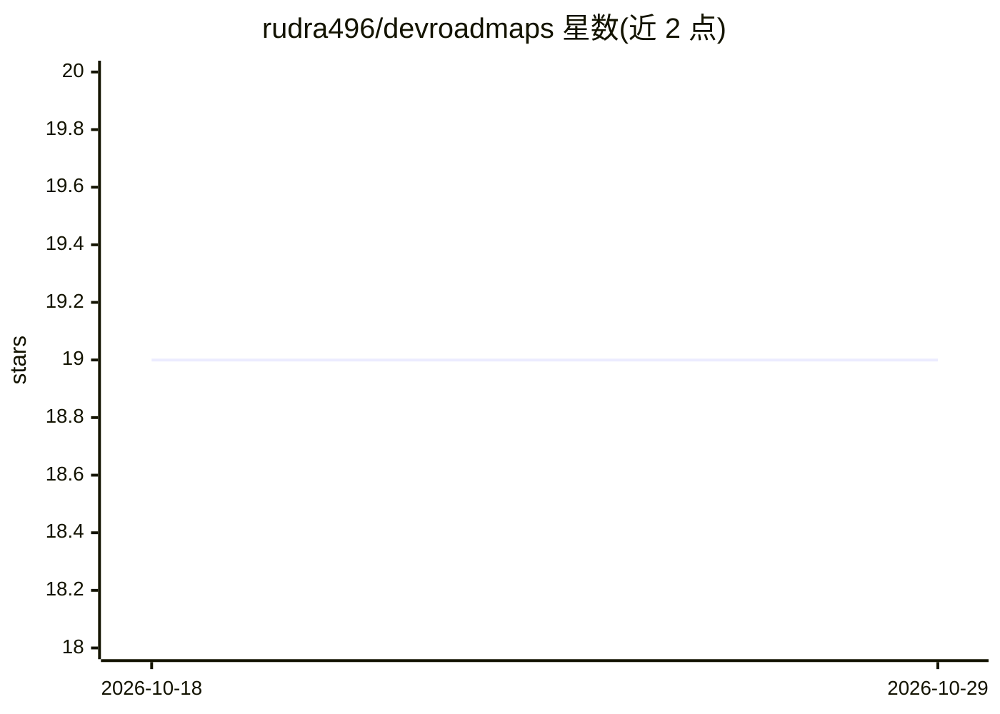

# rudra496/devroadmaps

⭐ 19 · JavaScript · MIT · 推送 2026-10-28 · [GitHub](https://github.com/rudra496/devroadmaps) · [官网](https://rudra496.github.io/devroadmaps) · 个人维护

**交互式开发者职业学习路线图站点：20 条路径与免费资源**

纯 HTML/CSS/JavaScript 实现的开源 Web 应用，提供 20 条开发方向路线图（前端到 AR/VR、平台工程到 SRE）、2000 余条免费学习资源与交互式进度追踪：点击主题标记完成、写学习笔记、每日编程挑战、技能雷达图、面试题准备、成就徽章与认证进度对照（AWS/GCP/CKA 等）。数据存于浏览器 LocalStorage，支持 PWA 离线使用，无构建步骤，可经 GitHub Pages 直接访问或本地起 Python HTTP 服务运行。

## 筛选速览

| 维度 | 判定 | 备注 |
|---|---|---|
| AI 角色 | `ai-knowledge` | 知识聚合/清单类 |
| 许可风险 | `permissive` | MIT |
| 部署形态 | `None` |  |
| 模型依赖 | — | README 未给出锁定关系 |
| 硬件要求 | — | 无带数字的原话,不猜 |
| 安装摩擦 | `low` | 无编译、无系统依赖或容器化 |
| 成熟度 | — | 结构信号不足 |

## 能力要点

- 20 条路线图与 2000+ 免费资源，可点击标记完成并追踪进度
- PWA 离线可用，零依赖纯 HTML/CSS/JS，无构建步骤
- 学习工具：每日挑战、技能雷达图、番茄钟、面试题与项目创意
- 认证进度对照 AWS/GCP/CKA/Security+ 等考试知识点

## 适用场景

- 按路线图规划从入门到高级的开发者学习路径
- 记录学习进度、笔记并通过每日挑战保持练习节奏
- 对照 AWS/GCP 等认证考试大纲检查知识覆盖情况

## 场景标签

`教程课程` · 领域:学习与行业

## 证据(README 行号)

> L12: **Free, open-source interactive developer roadmaps**
> L32: Most developer roadmap repos are just static images or markdown lists. **DevRoadmaps is interactive** — click any t

## 星数曲线

2026-10-18 19 → 2026-10-29 19（+0）

---
*卡片 v1 · prompt 1.4 · 生成 2026-10-28 · 置信度 mid · 依据 README sha `9ed14f8e68da` · [字段定义](../../DATASET.md)*
