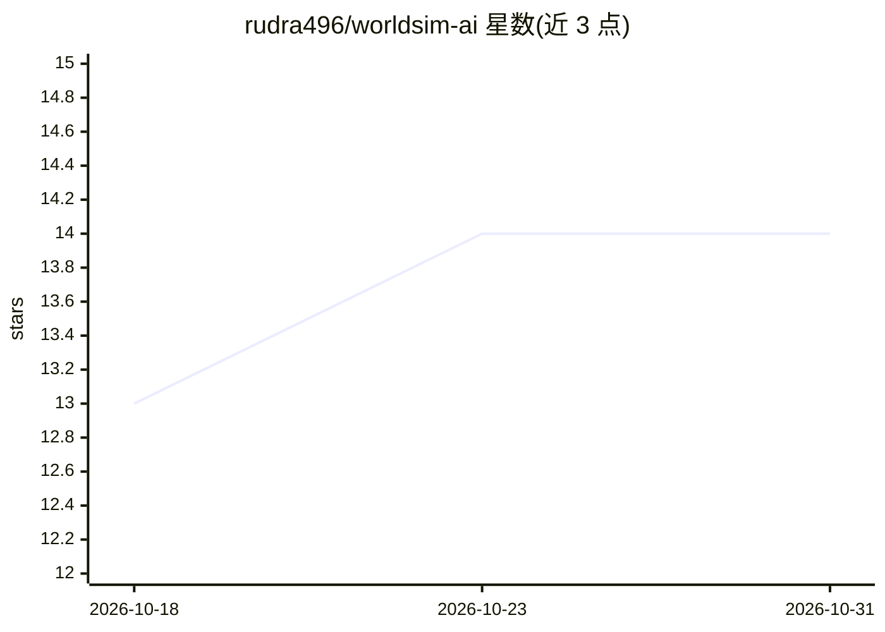

# rudra496/worldsim-ai

⭐ 14 · Python · MIT · 推送 2026-10-28 · [GitHub](https://github.com/rudra496/worldsim-ai) · [官网](https://rudra496.github.io/worldsim-ai/) · 个人维护

**AI 驱动的数字孪生仿真平台：建模预测优化现实系统**

开源（MIT）的智能体仿真与数字孪生平台，面向智慧城市、工厂、电网、物流等系统的建模、预测与优化。提供 4 类智能体（车辆/人/机器/能源单元）、2D 网格与图世界、8 种场景区类型；AI 部分含 PyTorch LSTM 时间序列预测（无 PyTorch 时回退 NumPy）、自编码器异常检测、线性规划资源优化、Gymnasium 兼容强化学习环境及 Planner/Predictor/Optimizer 多智能体协调。支持 Three.js 3D 可视化、MQTT/文件/REST 数据接入、gRPC 多节点分布式、GIS 集成与插件系统。Docker 一键启动，Python 3.10+，FastAPI 后端 + React 前端。

## 筛选速览

| 维度 | 判定 | 备注 |
|---|---|---|
| AI 角色 | `ai-native` | 本体是模型或模型工具 |
| 许可风险 | `permissive` | MIT |
| 部署形态 | `self-host` | docker 或自建部署 |
| 模型依赖 | — | README 未给出锁定关系 |
| 硬件要求 | — | 无带数字的原话,不猜 |
| 安装摩擦 | `low` | 无编译、无系统依赖或容器化 |
| 成熟度 | — | 结构信号不足 |

## 能力要点

- PyTorch LSTM 时间序列预测与自编码器异常检测
- Gymnasium 兼容 RL 环境与 PPO/Q-learning 智能体
- 8 个内置场景（智慧城市交通、工厂、电网、供应链等）
- 数字孪生三模式（live/replay/hybrid）+ GIS + 插件市场

## 适用场景

- 对城市交通或工厂产线做仿真与资源优化实验
- 接入 IoT 传感器数据构建实时数字孪生
- 在确定性模式下做可复现的仿真研究并导出结果

## 场景标签

`多智能体` `强化学习` · 领域:Agent 开发

## 证据(README 行号)

> L9: **AI-Powered Digital Twin Simulation Platform**
> L72: - **PyTorch LSTM predictor** — deep time-series forecasting (NumPy fallback when PyTorch unavailable)
> L76: - **Reinforcement learning** — Gymnasium-compatible environment with PPO/Q-learning agents

## 星数曲线

2026-10-18 13 → 2026-10-31 14（+1）

---
*卡片 v1 · prompt 1.4 · 生成 2026-10-31 · 置信度 high · 依据 README sha `a4268b1318aa` · [字段定义](../../DATASET.md)*
