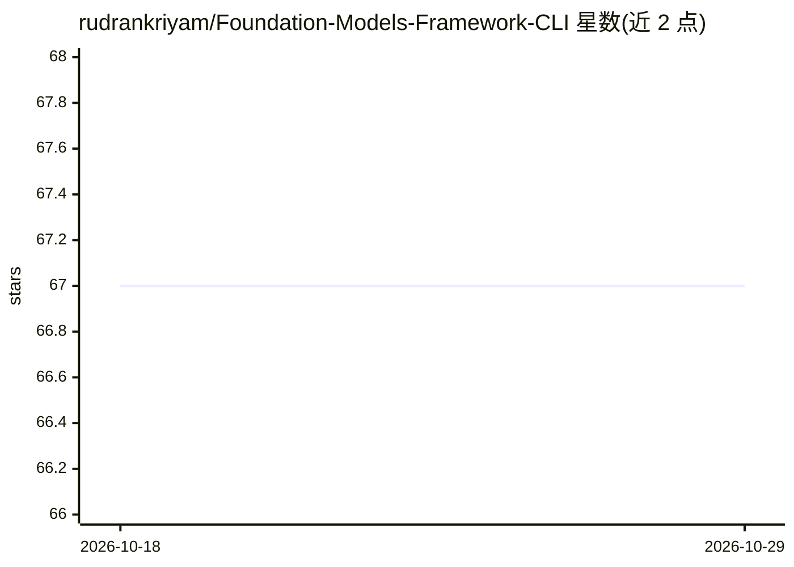

# rudrankriyam/Foundation-Models-Framework-CLI

⭐ 67 · Swift · MIT · 推送 2026-07-06 · [GitHub](https://github.com/rudrankriyam/Foundation-Models-Framework-CLI) · [官网](https://github.com/rudrankriyam/Foundation-Models-Framework-CLI) · 个人维护

**在终端与脚本中调用 Apple Foundation Models 的 Swift CLI**

Swift 命令行工具 afm，面向在终端、脚本、本地服务器与 agent 工作流中使用 Apple Foundation Models 框架的开发者：提供运行时可用性检查、提示词会话与流式输出、token 计数、结构化输出、工具校验、本地 OpenAI 风格聊天端点（afm serve），以及通过签名 Foundation Lab 宿主访问 Private Cloud Compute 的 bridge 通道。依赖 FoundationModelsKit；要求 macOS 26+、Swift 6.2+、Apple Silicon 与 Apple Intelligence；无签名进程仅能检查 PCC 边界，不能执行 PCC。源码编译安装。

## 筛选速览

| 维度 | 判定 | 备注 |
|---|---|---|
| AI 角色 | `ai-ecosystem` | LLM/agent 周边工具 |
| 许可风险 | `permissive` | MIT |
| 部署形态 | `None` |  |
| 模型依赖 | — | README 未给出锁定关系 |
| 硬件要求 | — | 无带数字的原话,不猜 |
| 安装摩擦 | `low` | 无编译、无系统依赖或容器化 |
| 成熟度 | — | 结构信号不足 |

## 能力要点

- afm serve 提供本地 OpenAI 风格聊天端点与浏览器 workbench UI
- token 计数、结构化输出 schema 运行、文件式工具校验与调用
- 通过签名 Foundation Lab 宿主桥接 Private Cloud Compute 的 PCC 通道
- 流式输出为换行分隔 JSON，管道/CI 下默认 JSON 输出

## 适用场景

- 在脚本和 CI 中调用 Apple 端侧 Foundation Models 并解析 JSON 输出
- 为本地 agent 工作流提供带认证的回环聊天端点
- 在发送请求前估算 prompt/schema/工具的 token 数

## 场景标签

`推理引擎` · 领域:训练与推理

## 证据(README 行号)

> L3: `afm` is a Swift command-line tool for working with Apple's Foundation Models framework from the terminal, scripts, 
> L9: Apple's native `fm` tool remains the system-owned interface. `afm` complements it with scriptable JSON output, reque
> L131: `afm serve` exposes local Foundation Models-compatible chat endpoints over TCP or a Unix-domain socket. This is th

## 星数曲线

2026-10-18 67 → 2026-10-29 67（+0）

---
*卡片 v1 · prompt 1.4 · 生成 2026-10-24 · 置信度 high · 依据 README sha `490ffb814ef9` · [字段定义](../../DATASET.md)*
