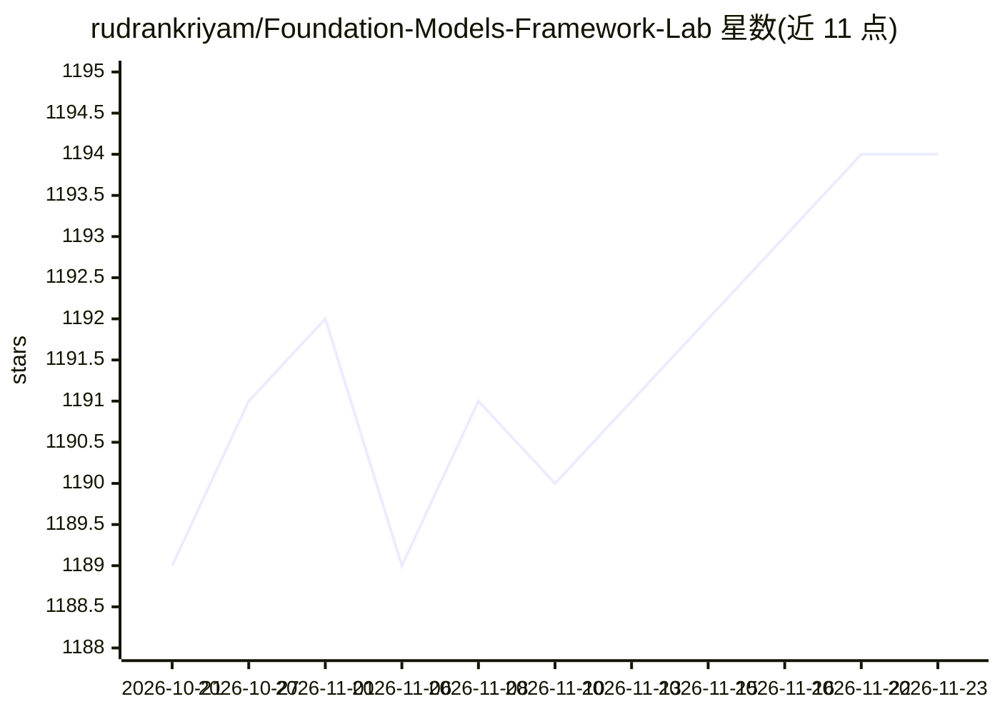

# rudrankriyam/Foundation-Models-Framework-Lab

⭐ 1,194 · Swift · MIT · 推送 2026-11-07 · [GitHub](https://github.com/rudrankriyam/Foundation-Models-Framework-Lab) · 个人维护

**测试 Apple 基础模型框架的 iOS/macOS 实验工作台**

原生 iOS 与 macOS 应用，围绕 Apple Foundation Models 框架组织学习与实验流程：包含 18 个可编辑配方、14 个引导实验、工作区与 Playground，可编辑提示词与指令、配置运行时与工具、流式输出、持久化运行历史并导出 Swift 代码与可复现证据。内置九个工具配方（天气、搜索、HealthKit 等），支持结构化输出、多语言会话、RAG 检索，另附适配器训练工具与独立 CLI 仓库。需 Apple Silicon 设备并启用 Apple Intelligence 才能实机运行模型。

## 筛选速览

| 维度 | 判定 | 备注 |
|---|---|---|
| AI 角色 | `ai-ecosystem` | LLM/agent 周边工具 |
| 许可风险 | `permissive` | MIT |
| 部署形态 | `library` | 以包/库形式分发 |
| 模型依赖 | — | README 未给出锁定关系 |
| 硬件要求 | — | 无带数字的原话,不猜 |
| 安装摩擦 | `medium` | 含编译或系统依赖之一 |
| 成熟度 | — | 结构信号不足 |

## 能力要点

- Library/Playground/Runs 三区结构：配方运行、提示编辑、运行证据检查
- 九个内置工具配方与可组合的工具界面
- 结构化输出（@Generable/@Guide）、多语言会话与 RAG 检索
- macOS 适配器对比工作区与 fmas 训练导出 CLI

## 适用场景

- 为 Apple Foundation Models 框架的各 API 逐项跑通示例
- 对比适配器前后同一提示词的输出与耗时
- 构建基于 HealthKit 授权数据的本地模型应用原型
- 导出 Playground 配置为 Swift 代码用于自建应用

## 场景标签

`提示工程` `RAG` · 领域:Agent 开发

## 证据(README 行号)

> L3: Foundation Lab is a native iOS and macOS workbench for learning, testing, and
> L4: shipping with Apple's Foundation Models framework. It keeps the prompt,
> L39: - **Guided Lab** uses a focused interface for a specific Foundation Models API.

## 星数曲线

2026-10-21 1,189 → 2026-11-23 1,194（+5）

---
*卡片 v1 · prompt 1.4 · 生成 2026-11-23 · 置信度 mid · 依据 README sha `b45285605b88` · [字段定义](../../DATASET.md)*
