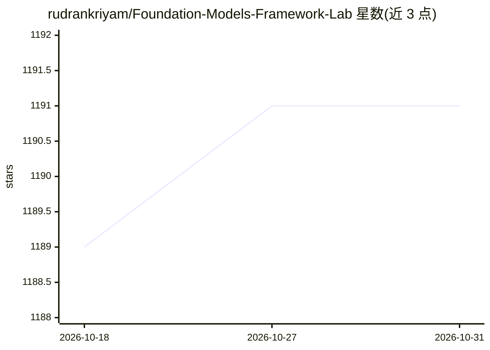

# rudrankriyam/Foundation-Models-Framework-Lab

⭐ 1,191 · Swift · MIT · 推送 2026-09-18 · [GitHub](https://github.com/rudrankriyam/Foundation-Models-Framework-Lab) · 个人维护

**开发者学习测试 Apple Foundation Models 框架的 iOS/macOS 工作台**

原生 iOS/macOS 应用，面向使用 Apple Foundation Models 框架的开发者：Library 提供 18 个可编辑 recipe 与 14 个 guided lab，Playground 支持编辑提示词、配置模型与工具、流式多轮对话、语音输入与 Swift 导出，Runs 记录运行证据。内置 9 个工具 recipe（天气、日历、HealthKit 等），支持结构化输出、RAG 检索、适配器对比。要求 iOS/macOS 26.0+、Apple Silicon 与 Apple Intelligence，模型实机运行需物理设备，从 Xcode 工程源码构建。

## 筛选速览

| 维度 | 判定 | 备注 |
|---|---|---|
| AI 角色 | `ai-ecosystem` | LLM/agent 周边工具 |
| 许可风险 | `permissive` | MIT |
| 部署形态 | `library` | 以包/库形式分发 |
| 模型依赖 | — | README 未给出锁定关系 |
| 硬件要求 | — | 无带数字的原话,不猜 |
| 安装摩擦 | `medium` | 含编译或系统依赖之一 |
| 成熟度 | — | 结构信号不足 |

## 能力要点

- 18 个可编辑 recipe、14 个 guided lab 与 3 个 workshop
- Playground 支持流式多轮对话、工具配置与 Swift 导出
- 9 个内置工具 recipe（HealthKit、日历、位置等）
- 适配器对比 workspace 与 Xcode 27 专属实验室

## 适用场景

- 学习和实验 Apple Foundation Models 各 API
- 对比不同提示词、配置与适配器的运行效果
- 检查每次运行的 transcript、工具调用与 token 用量

## 场景标签

`提示工程` `教程课程` · 领域:Agent 开发

## 证据(README 行号)

> L3: Foundation Lab is a native iOS and macOS workbench for learning, testing, and
> L4: shipping with Apple's Foundation Models framework. It keeps the prompt,
> L32: |Library|Browse 18 editable recipes, 14 guided labs, three workshops, saved experiments, and one workspace.|

## 星数曲线

2026-10-18 1,189 → 2026-10-31 1,191（+2）

---
*卡片 v1 · prompt 1.4 · 生成 2026-10-21 · 置信度 mid · 依据 README sha `93d8a1c772fc` · [字段定义](../../DATASET.md)*
