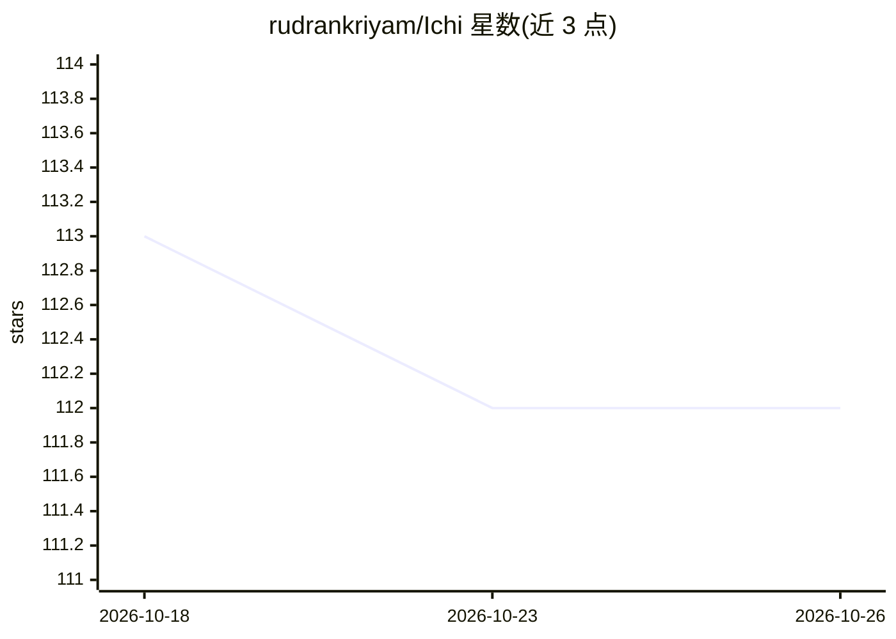

# rudrankriyam/Ichi

⭐ 112 · Swift · MIT · 推送 2026-08-31 · [GitHub](https://github.com/rudrankriyam/Ichi) · 个人维护

**Apple 平台端侧语音对话 AI 实验项目（macOS 已验证）**

个人实验性项目：在 Apple 平台探索端侧对话 AI，基于 SwiftUI 构建，当前仅 macOS 完成验证，iOS 与 visionOS 为期望目标。功能包括设备端 LLM 对话（使用 Qwen 模型）、实时语音识别、Kokoro TTS 语音合成与引导式模型下载安装，所有处理在设备本地完成。作者起因是线上 speech-to-speech 服务费用高，改走端侧路线，并计划用于日语入门学习。

## 筛选速览

| 维度 | 判定 | 备注 |
|---|---|---|
| AI 角色 | `ai-native` | 本体是模型或模型工具 |
| 许可风险 | `permissive` | MIT |
| 部署形态 | `None` |  |
| 模型依赖 | — | README 未给出锁定关系 |
| 硬件要求 | — | 无带数字的原话,不猜 |
| 安装摩擦 | `low` | 无编译、无系统依赖或容器化 |
| 成熟度 | `idea` | |

## 能力要点

- 端侧 LLM 对话（Qwen 模型）
- 实时语音转文字与 Kokoro TTS 语音合成
- 全部处理在设备本地，数据不出设备
- SwiftUI 应用外壳与引导式模型下载

## 适用场景

- 在 macOS 上体验完全离线的语音对话 AI
- 作为日语入门的个人学习陪练
- 探索 MLX audio 栈在 Apple 平台的语音交互开发

## 场景标签

`语音 Agent` · 领域:对话与助手

## 证据(README 行号)

> L9: Ichi is an experimental project that explores conversational AI capabilities on macOS (the only validated platform t
> L15: - **Privacy-First**: All processing happens on-device - no data leaves your device
> L17: - **Speech Recognition**: Real-time speech-to-text conversion

## 星数曲线

2026-10-18 113 → 2026-10-26 112（-1）

---
*卡片 v1 · prompt 1.4 · 生成 2026-10-23 · 置信度 mid · 依据 README sha `366dc71c363d` · [字段定义](../../DATASET.md)*
