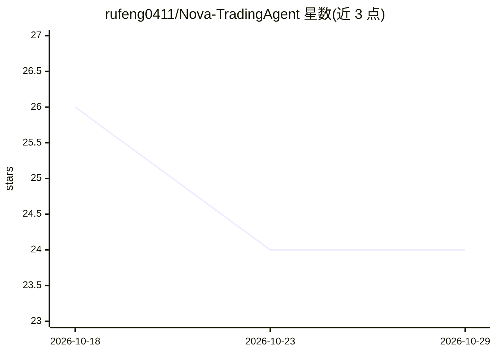

# rufeng0411/Nova-TradingAgent

⭐ 24 · Python · AGPL-3.0 · 推送 2026-09-10 · [GitHub](https://github.com/rufeng0411/Nova-TradingAgent) · [官网](https://rufeng0411.github.io/Nova-TradingAgent/) · 个人维护 · 中文 README

**自托管 A 股多智能体研究工作台：15 个 agent 辩论产出结构化研报**

基于上游 TradingAgents 辩论图的自托管 FastAPI Web 研究台，面向中国 A 股。用户提交股票代码后由 15 个专家 agent 分工完成研究、多空辩论、交易草案、风险质询与裁决，产出可留存的结构化报告；新增 ChartPro K 线工作台（含 AI 图表洞察）、约两分钟快速分析、LLM 前置翻译层、可选 Tushare L2 挂单队列接入与 Qlib 隔离沙盒桥、多用户积分订阅与管理后台。默认不下单、不连接券商。

## 筛选速览

| 维度 | 判定 | 备注 |
|---|---|---|
| AI 角色 | `ai-native` | 本体是模型或模型工具 |
| 许可风险 | `viral` | AGPL-3.0 |
| 部署形态 | `self-host` | docker 或自建部署 |
| 模型依赖 | — | README 未给出锁定关系 |
| 硬件要求 | — | 无带数字的原话,不猜 |
| 安装摩擦 | `low` | 无编译、无系统依赖或容器化 |
| 成熟度 | — | 结构信号不足 |

## 能力要点

- 15-agent 研究图：多空辩论、交易草案、风险裁决到结构化报告
- 数据先蒸馏为结论再进 LLM 的翻译层，供应商缺失时软降级
- ChartPro K 线工作台（MA/布林/MACD 标注、AI 图表洞察）
- 可选 Tushare L2 挂单队列与 Qlib 隔离文件桥（均默认关闭）

## 适用场景

- 自部署一套 A 股研究台，跑多智能体辩论并留存研报
- 看 K 线时获取 AI 图表洞察与两分钟快速结论
- 团队共用一个实例，用积分与订阅管理多人用量

## 场景标签

`多智能体` `金融量化` · 领域:Agent 开发

## 证据(README 行号)

> L31: **Nova-TradingAgent** is a self-hosted multi-agent research workbench for China A-shares. You run FastAPI plus a bu
> L33: It keeps the original TradingAgents idea: a graph that sequences analysts, opposing researchers, a trader, and risk

## 星数曲线

2026-10-18 26 → 2026-10-29 24（-2）

---
*卡片 v1 · prompt 1.4 · 生成 2026-10-27 · 置信度 mid · 依据 README sha `df57d8c6d8e1` · [字段定义](../../DATASET.md)*
