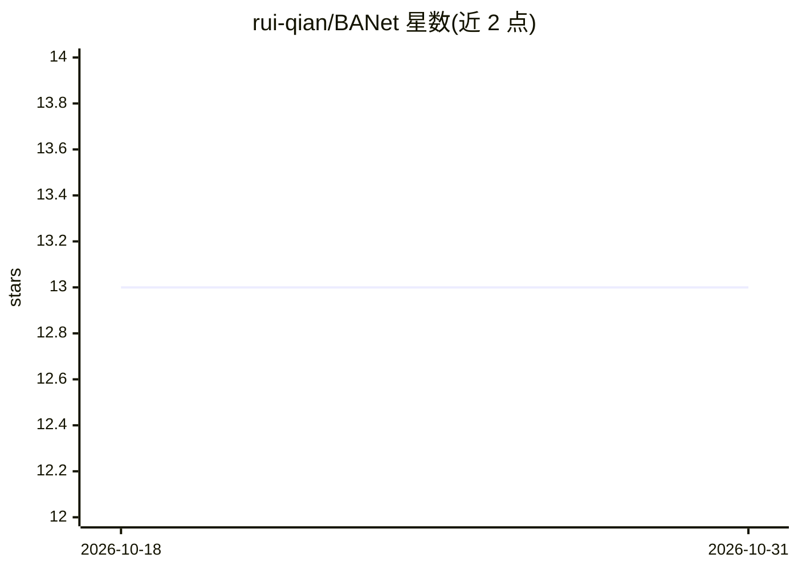

# rui-qian/BANet

⭐ 13 · 推送 2026-02-12 · [GitHub](https://github.com/rui-qian/BANet) · 个人维护 · 中文 README

**点云边界感知 3D 目标检测方法 BADet 的论文主页**

该仓库是论文《BADet: Boundary-Aware 3D Object Detection from Point Clouds》（Pattern Recognition 2022）的主页，作者为 Rui Qian、Xin Lai、Xirong Li。README 声明截至 2021 年 4 月 17 日该方法在 KITTI BEV 检测榜单已发表文献中列第 1，检测器运行速度 7.1 FPS，并提供 arXiv、Elsevier 与代码仓库链接。仓库说明其保留仅为方便查询相关硕士论文《基于点云的边界感知3D目标检测》，具体代码需前往 rui-qian/BADet 仓库。

## 筛选速览

| 维度 | 判定 | 备注 |
|---|---|---|
| AI 角色 | `ai-native` | 本体是模型或模型工具 |
| 许可风险 | `none` | — |
| 部署形态 | `None` |  |
| 模型依赖 | — | README 未给出锁定关系 |
| 硬件要求 | — | 无带数字的原话,不猜 |
| 安装摩擦 | `low` | 无编译、无系统依赖或容器化 |
| 成熟度 | — | 结构信号不足 |

## 能力要点

- KITTI BEV 检测榜单（截至 2021-04-17 已发表文献）第 1 名
- 检测器运行速度 7.1 FPS
- 提供 arXiv 与 Pattern Recognition 论文链接

## 适用场景

- 查阅边界感知 3D 目标检测方法的论文与出处
- 引用该方法进行点云目标检测相关研究

## 场景标签

`目标检测` · 领域:感知与多模态

## 证据(README 行号)

> L5: # BADet: Boundary-Aware 3D Object Detection from Point Clouds (Pattern Recognition 2022: IF=8.518)
> L6: As of Apr. 17th, 2021, 1 st place in KITTI BEV detection leaderboard and on par performance on KITTI 3D detection le

## 星数曲线

2026-10-18 13 → 2026-10-31 13（+0）

---
*卡片 v1 · prompt 1.4 · 生成 2026-10-31 · 置信度 high · 依据 README sha `0c111782b567` · [字段定义](../../DATASET.md)*
