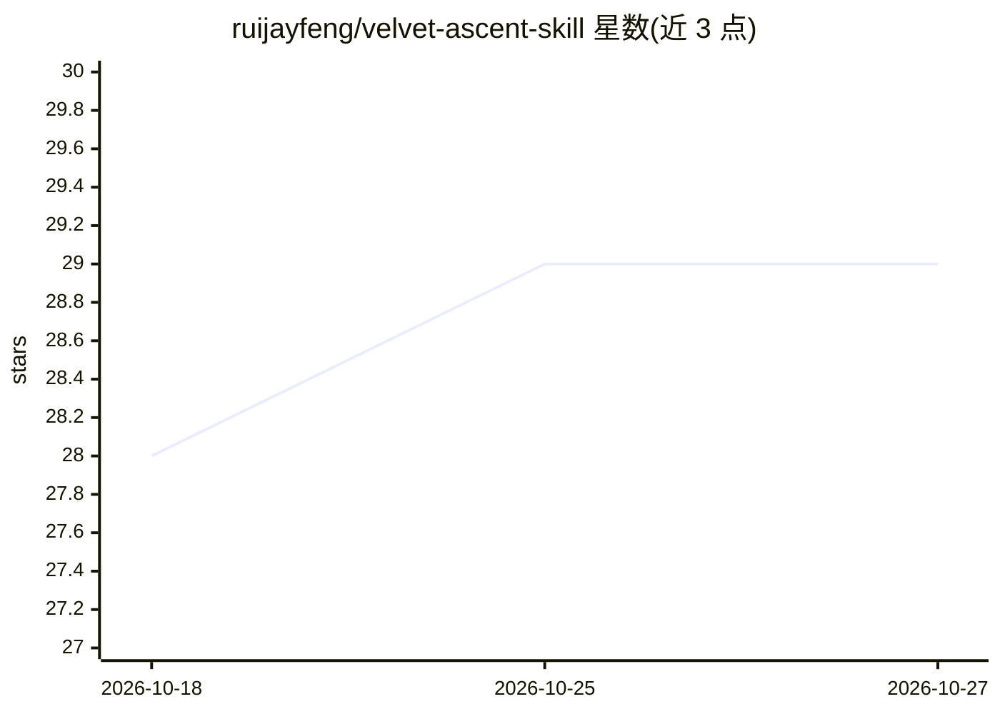

# ruijayfeng/velvet-ascent-skill

⭐ 29 · HTML · MIT · 推送 2026-07-13 · [GitHub](https://github.com/ruijayfeng/velvet-ascent-skill) · [官网](https://www.npmjs.com/package/@ruizhefeng/velvet-ascent-skill) · 个人维护 · 中文 README

**给 AI Agent 装的中文成人向文字 GalGame GM 技能**

Velvet Ascent 是一个安装到支持 skills 的 AI Agent 中的中文文字游戏 GM 技能包，把对话变成自由的后宫养成 GalGame。机制包括：角色 6 阶段养成、每角色 3-5 项 XP 偏好与反应序列、欲望图谱与 0-4 级 NSFW 档位双重约束、单时间线推进、8 文件工作区的文档记忆系统，游戏结束后可导出为小说草稿。通过 npx 安装到 ~/.agents/skills 目录，提供 14 个游戏内命令。内容边界限定为虚构成年角色、合意互动。

## 筛选速览

| 维度 | 判定 | 备注 |
|---|---|---|
| AI 角色 | `ai-native` | 本体是模型或模型工具 |
| 许可风险 | `permissive` | MIT |
| 部署形态 | `library` | 以包/库形式分发 |
| 模型依赖 | — | README 未给出锁定关系 |
| 硬件要求 | — | 无带数字的原话,不猜 |
| 安装摩擦 | `low` | 无编译、无系统依赖或容器化 |
| 成熟度 | — | 结构信号不足 |

## 能力要点

- 后宫养成 6 阶段：路人→吸引→试探→暧昧→亲密→入后宫
- 角色 XP 与反应序列、欲望图谱 + NSFW 0-4 档位双重约束
- 8 文件文档记忆工作区追踪人物、关系、伏笔与时间线
- 游戏结束后整理导出为完整小说草稿

## 适用场景

- 通过自然语言开局玩中文后宫养成文字游戏
- 长期剧情游戏中保持人物关系与伏笔记忆
- 把游戏过程整理导出为小说草稿

## 场景标签

 · 领域:游戏/互动小说

## 证据(README 行号)

> L5:  AI Agent 用的中文后宫养成文字游戏 GM，结构化升温，NSFW 档位可控。
> L20: Velvet Ascent 是给支持 skills 的 AI Agent 装的一个中文文字游戏 GM。它把对话变成一场自由的后宫养成 GalGame——你可以用自然语言指定世界观、人物关系、角色 XP、剧情尺度和长期记忆，前期铺垫

## 星数曲线

2026-10-18 28 → 2026-10-27 29（+1）

---
*卡片 v1 · prompt 1.4 · 生成 2026-10-26 · 置信度 high · 依据 README sha `5bb32352cffb` · [字段定义](../../DATASET.md)*
