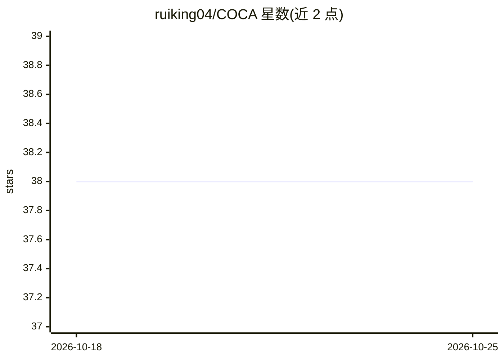

# ruiking04/COCA

⭐ 38 · Python · 推送 2026-06-25 · [GitHub](https://github.com/ruiking04/COCA) · 个人维护

**COCA：基于对比学习与单类分类的时间序列异常检测方法实现**

论文 Deep Contrastive One-Class Time Series Anomaly Detection 的官方 PyTorch 实现。方法将原始与重构表示作为正样本对，构成无需负样本的序列对比学习，用不变项与方差项组成对比单类损失以防止超球面坍缩。依赖 Merlion 与 Tsaug 库，在 IOpsCompetition 与 UCR（250 子集）数据集上实验，UCR 各子集需单独调 epoch（≤50）。Python 3.8 环境，运行前需解压 phase2.zip 数据，通过命令行脚本训练评估。

## 筛选速览

| 维度 | 判定 | 备注 |
|---|---|---|
| AI 角色 | `ai-native` | 本体是模型或模型工具 |
| 许可风险 | `none` | — |
| 部署形态 | `library` | 以包/库形式分发 |
| 模型依赖 | — | README 未给出锁定关系 |
| 硬件要求 | — | 无带数字的原话,不猜 |
| 安装摩擦 | `medium` | 含编译或系统依赖之一 |
| 成熟度 | — | 结构信号不足 |

## 能力要点

- 无需负样本的序列对比学习（原始与重构表示构成正样本对）
- 不变项+方差项组成的对比单类损失，防止超球面坍缩
- 支持 IOpsCompetition 与 UCR 两个数据集的实验配置

## 适用场景

- 在无标签时间序列数据上做异常检测研究
- 复现论文实验或对比基线方法
- 基于 Merlion 生态扩展异常检测模型

## 场景标签

 · 领域:时间序列异常检测/深度学习

## 证据(README 行号)

> L2: This repository provides the implementation of the _Deep Contrastive One-Class Time Series Anomaly Detection_ method
> L12: > Anomaly detection method of time series (COCA) is proposed by authors, following the normality assumptions of CL 

## 星数曲线

2026-10-18 38 → 2026-10-25 38（+0）

---
*卡片 v1 · prompt 1.4 · 生成 2026-10-25 · 置信度 mid · 依据 README sha `40b9a99cb272` · [字段定义](../../DATASET.md)*
