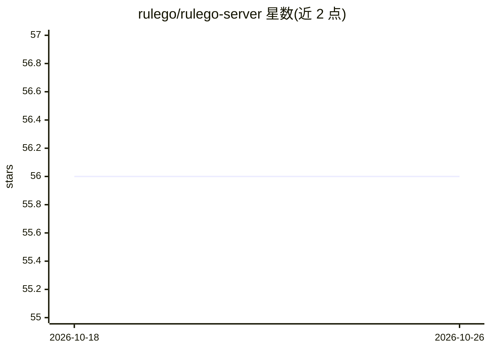

# rulego/rulego-server

⭐ 56 · JavaScript · NOASSERTION · 推送 2026-04-16 · [GitHub](https://github.com/rulego/rulego-server) · 组织维护 · 中文 README

**基于 RuleGo 的轻量工作流自动化平台，含 MCP 与 AI 组件**

基于 RuleGo 构建的轻量级模块化自动化工作流平台，面向自动化编排、iPaaS、API/应用/AI 编排、数据处理与 IoT 规则引擎等场景。内置 100+ 组件与可视化规则链，支持热更新、多租户、JWT/api_key 鉴权。AI 能力方面：支持大模型组件（with_ai 编译标签），并可将所有组件、规则链与 API 自动注册为 MCP 工具，供 AI 助手调用。以 Go 源码编译方式部署，无需数据库。

## 筛选速览

| 维度 | 判定 | 备注 |
|---|---|---|
| AI 角色 | `ai-ecosystem` | LLM/agent 周边工具 |
| 许可风险 | `none` | NOASSERTION |
| 部署形态 | `None` |  |
| 模型依赖 | — | README 未给出锁定关系 |
| 硬件要求 | — | 无带数字的原话,不猜 |
| 安装摩擦 | `low` | 无编译、无系统依赖或容器化 |
| 成熟度 | — | 结构信号不足 |

## 能力要点

- 内置 100+ 组件，支持组件市场与规则链市场动态安装
- 自动将组件、规则链与 API 注册为 MCP 工具
- 支持大模型组件（with_ai 扩展编译标签）
- 多租户与规则链数据隔离，工作流热更新

## 适用场景

- 搭建 iPaaS/API 编排等自动化工作流平台
- 将第三方系统服务封装为 MCP 工具供 AI 助手调用
- 构建 IoT 规则引擎与数据处理流

## 场景标签

`工作流自动化` · 领域:效率与自动化

## 证据(README 行号)

> L21: - **AI Support:** Supports large model components. The system automatically registers all components and rule chain
> L104: RuleGo-Server supports MCP (Model Context Protocol).
> L106: This allows AI assistants (such as Windsurf, Cursor, Codeium, etc.) to directly call these tools through the MCP p

## 星数曲线

2026-10-18 56 → 2026-10-26 56（+0）

---
*卡片 v1 · prompt 1.4 · 生成 2026-10-24 · 置信度 high · 依据 README sha `39ca94476e7f` · [字段定义](../../DATASET.md)*
