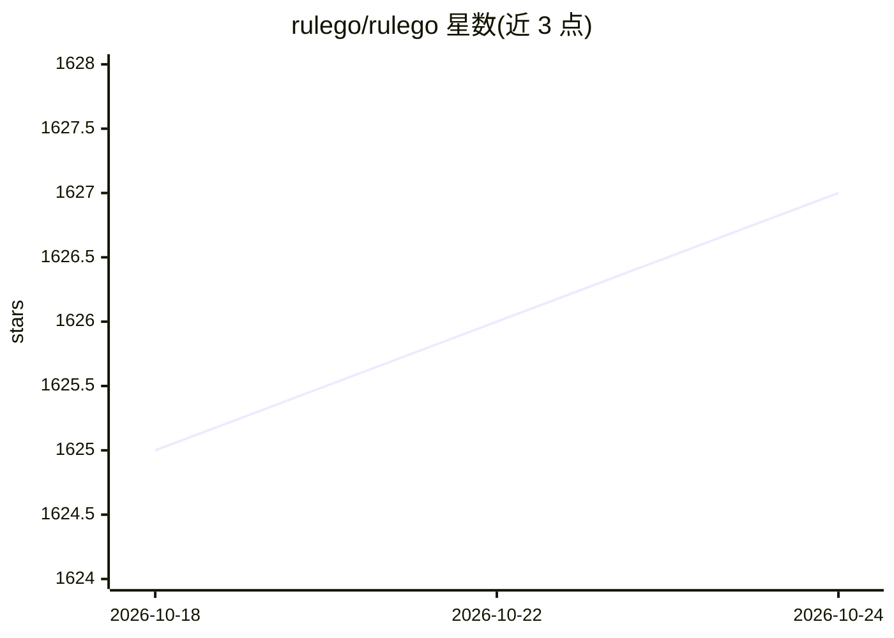

# rulego/rulego

⭐ 1,627 · Go · Apache-2.0 · 推送 2026-10-19 · [GitHub](https://github.com/rulego/rulego) · [官网](https://rulego.cc) · 组织维护 · 中文 README

**Go 轻量级组件化规则引擎，用于业务编排与数据集成**

用 Go 编写的轻量嵌入式规则引擎框架：以 JSON DSL 定义规则链，内置过滤、转换、分发、HTTP/MQTT 推送等组件，支持动态加载与不重启更新业务逻辑、嵌套子链、AOP 与 Endpoint 数据集成（HTTP/MQTT/TCP/UDP/Kafka 等）。可嵌入现有应用或独立部署，适用于低代码、数据集成、IoT、边缘计算及大模型智能体编排等场景；另有 rulego-components-ai 等扩展组件库与 RuleGo-Server 平台。通过 go get 安装。

## 筛选速览

| 维度 | 判定 | 备注 |
|---|---|---|
| AI 角色 | `ai-enhanced` | 去掉 AI 部分产品仍成立 |
| 许可风险 | `permissive` | Apache-2.0 |
| 部署形态 | `None` |  |
| 模型依赖 | — | README 未给出锁定关系 |
| 硬件要求 | — | 无带数字的原话,不猜 |
| 安装摩擦 | `low` | 无编译、无系统依赖或容器化 |
| 成熟度 | — | 结构信号不足 |

## 能力要点

- JSON DSL 定义规则链，DAG 表示消息处理路径
- 双模式：嵌入现有应用或独立部署
- 动态加载组件与规则链，不重启更新业务逻辑
- Endpoint 模块集成 HTTP/MQTT/TCP/UDP/Kafka 等协议

## 适用场景

- IoT 边缘侧对设备数据做过滤、聚合后再上云
- 把频繁变化的业务逻辑从代码中解耦，用规则链管理
- 作为系统间胶水层对接多种协议与第三方应用
- 编排大模型智能体工作流

## 场景标签

`工作流自动化` `Agent 框架` · 领域:Agent 开发

## 证据(README 行号)

> L18: `RuleGo` is a lightweight, high-performance, embedded, orchestrable component-based rule engine built on the Go lan
> L23: It has a wide range of application potential in low-code, business code orchestration, data integration, workflows,
> L65: * **Low Code:** For example, low-code platforms, iPaaS systems, ETL, LangFlow-like systems (interfacing with large 

## 星数曲线

2026-10-18 1,625 → 2026-10-24 1,627（+2）

---
*卡片 v1 · prompt 1.4 · 生成 2026-10-21 · 置信度 mid · 依据 README sha `194da453c606` · [字段定义](../../DATASET.md)*
