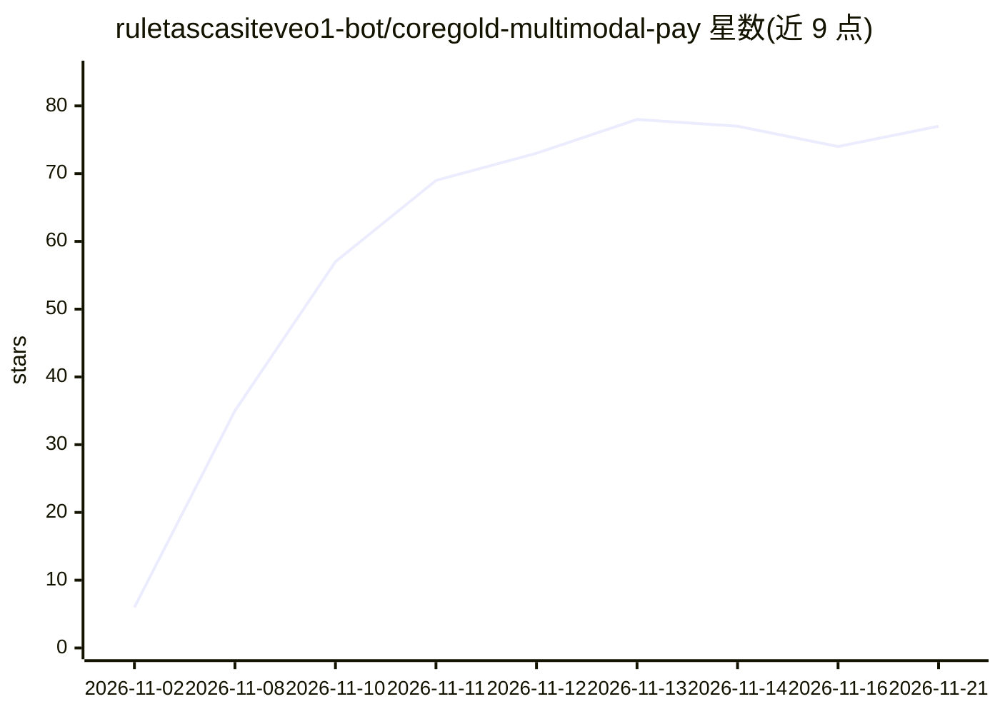

# ruletascasiteveo1-bot/coregold-multimodal-pay

⭐ 77 · 推送 2026-11-02 · [GitHub](https://github.com/ruletascasiteveo1-bot/coregold-multimodal-pay) · [官网](https://app.coregold.io/signup?invite_code=ADvlj9b) · 组织维护 · 中文 README

**面向视频 AI 订阅付费的商业虚拟卡服务推广**

这是一个推广 CoreGold 虚拟卡服务的营销型 README，非软件项目：宣称提供海外 Visa/Mastercard 商业虚拟卡，用 USDT 充值，为 Sora、Runway、Pika、Midjourney 等视频 AI 平台的订阅付费生成独立卡号、限额与英文账单地址，宣称可应对跨境大额订阅被拒、多账号关联封禁等场景，支持卡片注销与余额退回。全篇为服务卖点介绍与对比表格，无代码、无安装方式，仅含注册入口文案与末尾一串哈希。

## 筛选速览

| 维度 | 判定 | 备注 |
|---|---|---|
| AI 角色 | `ai-enhanced` | 去掉 AI 部分产品仍成立 |
| 许可风险 | `none` | — |
| 部署形态 | `None` |  |
| 模型依赖 | — | README 未给出锁定关系 |
| 硬件要求 | — | 无带数字的原话,不猜 |
| 安装摩擦 | `low` | 无编译、无系统依赖或容器化 |
| 成熟度 | — | 结构信号不足 |

## 能力要点

- 宣称生成海外 Visa/Mastercard 商业虚拟卡，USDT 充值为 USD 余额
- 单卡限额、独立卡号与英文账单地址，用于视频 AI 平台订阅付款
- 宣称支持一键注销卡片、余额退回母账户

## 适用场景

- 为海外视频 AI 平台订阅生成虚拟卡付款
- 多账号场景下一号一卡隔离扣费
- 项目结束后注销卡片回收余额

## 场景标签

 · 领域:支付服务/推广

## 证据(README 行号)

> L2: 别让支付卡死生成式视频！用 CoreGold 解决 Sora / Runway / 顶流视频 AI 充值风控
> L7: > 用 **CoreGold** 生成独立的海外 Visa / Mastercard 商业虚拟卡，直通高权重商业 BIN，USDT 随充随划，给每个视频生成账号独立上锁，杜绝扣费失败与跨号连坐。
> L38: 👉 **点击注册并进入 CoreGold 发卡后台**

## 星数曲线

2026-11-02 6 → 2026-11-21 77（+71）

---
*卡片 v1 · prompt 1.4 · 生成 2026-11-18 · 置信度 mid · 依据 README sha `9208ae012911` · [字段定义](../../DATASET.md)*
