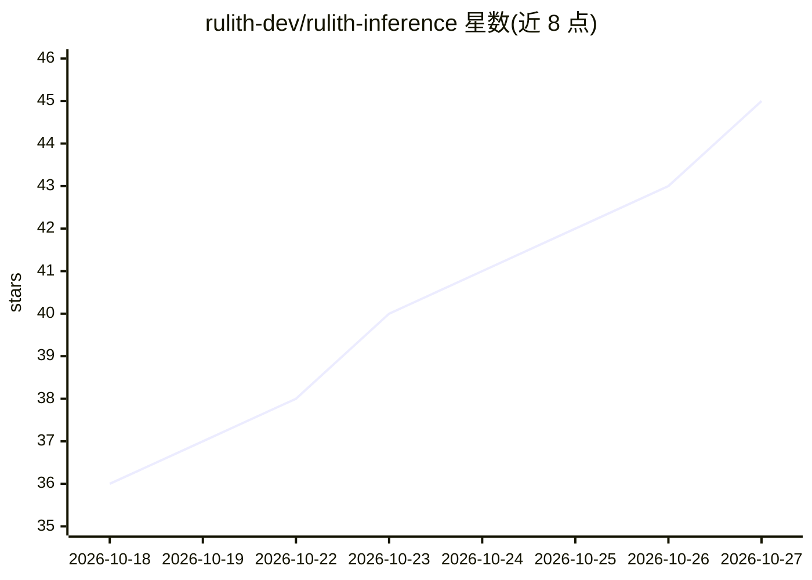

# rulith-dev/rulith-inference

⭐ 45 · Python · MIT · 推送 2026-10-26 · [GitHub](https://github.com/rulith-dev/rulith-inference) · 个人维护 · 中文 README

**在单台 AMD Strix Halo Windows 机器上快速服务 125B MoE 模型的推理套件**

由打过补丁的 llama.cpp（181 文件改动）、JSON-on-stdin 进程管理器和桌面应用组成，面向 Ryzen AI Max+ 395（gfx1151、128GB 统一内存）运行 Qwen3.8-Flash-Next（125B-A6B）。改动包括 gfx1151 专属专家内核、IQ3_S 矩阵核路径、解码期稀疏注意力与 MTP 投机解码；提供 OpenAI 兼容端点、Responses API 与 Anthropic Messages 路由，可供 Codex、Claude Code 等编码 agent 接入。发布页提供免 Python/ROCm 的安装器；源码构建需 ROCm SDK 并自行下载约 95GB 模型文件，Linux 仅补丁分支可构建、无安装器。

## 筛选速览

| 维度 | 判定 | 备注 |
|---|---|---|
| AI 角色 | `ai-ecosystem` | LLM/agent 周边工具 |
| 许可风险 | `permissive` | MIT |
| 部署形态 | `desktop` | 安装包/桌面程序 |
| 模型依赖 | local-ok | 支持本地模型 |
| 硬件要求 | `gpu-24g` | |
| 安装摩擦 | `medium` | 含编译或系统依赖之一 |
| 成熟度 | — | 结构信号不足 |

## 能力要点

- 针对 gfx1151 的专家内核与预填批次重写（含每项改动附命令的实测数据）
- OpenAI 兼容 /v1 端点，另支持 Responses API 与 Anthropic Messages 路由
- MTP 投机解码、按并发缩放的草稿长度、跟随 agent 的前缀缓存
- releases 安装器路径无需 Python、ROCm 或构建工具

## 适用场景

- 在 Strix Halo 整机上本地跑 125B MoE 模型给桌面应用或 API 用
- 让 Codex、Claude Code 等编码 agent 接入本地模型服务
- 多会话并发解码与长上下文（110K+ tokens）本地推理

## 场景标签

`推理引擎` · 领域:训练与推理

## 证据(README 行号)

> L91: The server it starts is an OpenAI-compatible endpoint, by default at `http://127.0.0.1:8080/v1`. In the
> L101: Coding agents can use the same server. Since 0.5.3 it serves OpenAI's Responses API (`/v1/responses`) well
> L113: Claude Code talks to the Anthropic Messages route (`/v1/messages`, streaming and `tool_use` / `tool_result`

## 星数曲线

2026-10-18 36 → 2026-10-27 45（+9）

---
*卡片 v1 · prompt 1.4 · 生成 2026-10-25 · 置信度 high · 依据 README sha `6eb46745cf76` · [字段定义](../../DATASET.md)*
