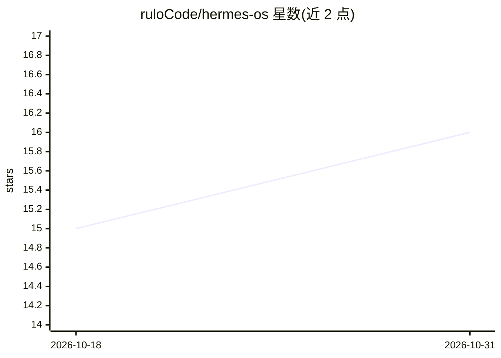

# ruloCode/hermes-os

⭐ 16 · TypeScript · MIT · 推送 2026-10-25 · [GitHub](https://github.com/ruloCode/hermes-os) · 个人维护

**本地优先的个人 AI 操作系统：语音、Agent 执行与会议助手**

面向个人用户的本地优先 AI 操作系统（西班牙语 UI/文档，代码英文）：基于 Claude Agent SDK 在本机运行执行型 Agent，通过 Claude Code 订阅 OAuth 登录而非 API key；提供实时语音（ElevenLabs WebRTC）、pgvector/Supabase 持久记忆、直播会议转写与 Copilot、Linear 任务、内容制作流水线、MediaPipe 手势控制，以及 3D『Agent 办公室』可视化视图。需 Node 22+/pnpm 10+、Supabase 项目；系统级功能（手势、灯光等）仅 macOS，其他系统自动停用。以 monorepo 源码方式安装，MIT 许可，作者声明为个人项目。

## 筛选速览

| 维度 | 判定 | 备注 |
|---|---|---|
| AI 角色 | `ai-native` | 本体是模型或模型工具 |
| 许可风险 | `permissive` | MIT |
| 部署形态 | `library` | 以包/库形式分发 |
| 模型依赖 | locked-api |  |
| 硬件要求 | — | 无带数字的原话,不猜 |
| 安装摩擦 | `medium` | 含编译或系统依赖之一 |
| 成熟度 | — | 结构信号不足 |

## 能力要点

- Claude Agent SDK 执行 Agent，使用 Claude Code 订阅 OAuth 登录（无需 API key）
- 3D Agent 办公室：展示 loop 轨迹、tools 权限与完整 system prompt
- 实时会议转写（说话人分离）+ 约 2 秒响应 Copilot，产出推送 Linear
- pgvector 统一知识检索：记忆、会议、执行记录与 Obsidian vault

## 适用场景

- 用语音与本机运行的 Agent 对话并让其执行任务
- 整理会议要点并自动生成 Linear 任务
- 个人知识（笔记、记忆、对话）统一检索与持久记忆

## 场景标签

`AI 助手` `语音 Agent` `知识库管理` `语音识别` · 领域:对话与助手

## 证据(README 行号)

> L10: Sistema operativo de IA personal, **local-first** y en español: un dashboard estilo "AGENTIC OS" con voz en tiempo 
> L50: Hermes → @anthropic-ai/claude-agent-sdk → query() → spawnea el CLI `claude`
> L120: - **Voz en tiempo real** (ElevenLabs): client tools en el browser → agente local, sin túnel. Segundo agente "tutor

## 星数曲线

2026-10-18 15 → 2026-10-31 16（+1）

---
*卡片 v1 · prompt 1.4 · 生成 2026-10-30 · 置信度 mid · 依据 README sha `1fa525d84aec` · [字段定义](../../DATASET.md)*
