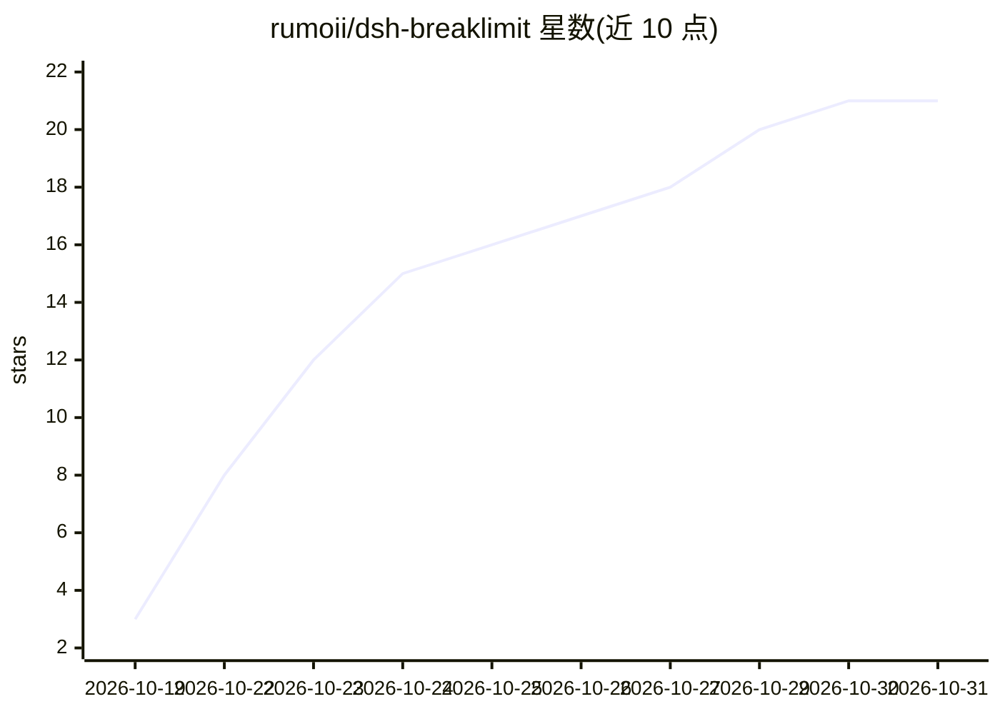

# rumoii/dsh-breaklimit

⭐ 21 · JavaScript · MIT · 推送 2026-10-26 · [GitHub](https://github.com/rumoii/dsh-breaklimit) · 个人维护 · 中文 README

**DeepSeek Harness 的破限插件：管理宿主补丁、提示词与规则集**

面向已能运行源码版 DeepSeek Harness 0.2.1-rc.2 的用户，以插件形式逐条应用可选的宿主源码补丁（应用前校验文件哈希与命中数，失败尝试事务回滚，可整批撤销），并提供中英文 Web 设置页管理两档可自定义提示词（recommended/unrestricted）、写入 AGENTS.md 或 CLAUDE.md 的规则集及目标词替换表。安装要求 Node.js、Git、pnpm，仅支持特定宿主提交（687f282e），桌面发行版和其他宿主版本尚未验收。本机运行，不收集遥测，仅有的对外请求是可关闭的 GitHub 更新检查。当前 0.9.5 内测版，MIT 许可。

## 筛选速览

| 维度 | 判定 | 备注 |
|---|---|---|
| AI 角色 | `ai-ecosystem` | LLM/agent 周边工具 |
| 许可风险 | `permissive` | MIT |
| 部署形态 | `None` |  |
| 模型依赖 | — | README 未给出锁定关系 |
| 硬件要求 | — | 无带数字的原话,不猜 |
| 安装摩擦 | `low` | 无编译、无系统依赖或容器化 |
| 成熟度 | `idea` | |

## 能力要点

- 逐条可选的宿主源码补丁，应用前检查哈希与命中数，支持事务回滚
- 两档提示词（recommended/unrestricted）与自定义正文，写入 $DSH_HOME/breaklimit-inject.md
- 多份规则管理，激活到 AGENTS.md 或 CLAUDE.md，撤销时保留并报告外部改动
- 五层只读诊断（磁盘补丁/进程预算/提示词装配/请求前处理/执行权限），区分生效、未知与不适用

## 适用场景

- 我在用源码版 DeepSeek Harness，想按条选择移除宿主的提示词限制与审批拦截
- 我需要随时撤销补丁、还原宿主源码
- 我想用 Web 设置页管理提示词档位、规则集和目标词替换表

## 场景标签

`提示工程` · 领域:Agent 开发

## 证据(README 行号)

> L3: 为 DeepSeek Harness 管理宿主补丁、提示词和规则集的插件，提供中英文 Web 设置页。
> L34: |宿主|已能运行的 DeepSeek Harness **源码版** `0.2.1-rc.2`|

## 星数曲线

2026-10-19 3 → 2026-10-31 21（+18）

---
*卡片 v1 · prompt 1.4 · 生成 2026-10-29 · 置信度 high · 依据 README sha `8fe681e17608` · [字段定义](../../DATASET.md)*
