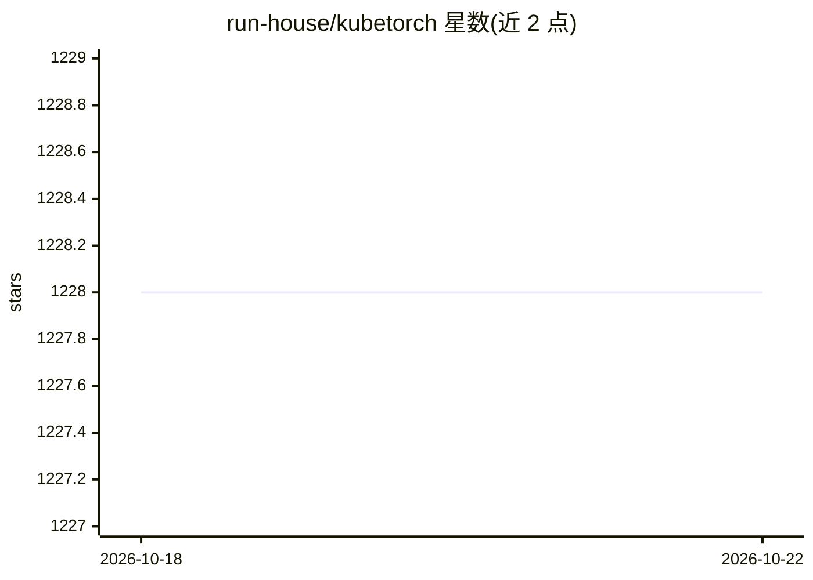

# run-house/kubetorch

⭐ 1,228 · Python · Apache-2.0 · 推送 2026-05-29 · [GitHub](https://github.com/run-house/kubetorch) · [官网](https://run.house) · 组织维护

**在 Python 中把 ML 工作负载部署到 Kubernetes 的接口**

Kubetorch 提供一个 Pythonic 的"无服务器"接口，让开发者从本地 Python 环境（IDE、notebook、CI、生产代码）直接构建、迭代并部署 ML 应用到 Kubernetes 集群，宣称迭代速度 1-2 秒，日志、异常与硬件故障实时回传。无本地运行时与代码序列化，集群算力像本地进程池一样使用。安装分两部分：pip 安装 Python 客户端，Helm 部署 Kubernetes 组件；另提供联系厂商试用的全托管 serverless 平台。仓库包含 SDK、Helm chart、控制器与数据存储源码。

## 筛选速览

| 维度 | 判定 | 备注 |
|---|---|---|
| AI 角色 | `ai-ecosystem` | LLM/agent 周边工具 |
| 许可风险 | `permissive` | Apache-2.0 |
| 部署形态 | `library` | 以包/库形式分发 |
| 模型依赖 | — | README 未给出锁定关系 |
| 硬件要求 | — | 无带数字的原话,不猜 |
| 安装摩擦 | `low` | 无编译、无系统依赖或容器化 |
| 成熟度 | — | 结构信号不足 |

## 能力要点

- 从任意 Python 环境调用 Kubernetes 集群算力，无本地运行时与代码序列化
- 日志、异常与硬件故障实时回传
- 仓库含 Python SDK、Helm chart、控制器与数据存储源码
- 提供全托管 serverless 平台（联系厂商试用）

## 适用场景

- 在本地 IDE/notebook 中迭代分布式训练或 RL 等 ML 应用并部署到集群
- 通过 Python 接口调度 Kubernetes 算力运行推理与数据处理工作负载
- 在 CI 流水线中复用同一接口运行大规模 ML 任务

## 场景标签

`MLOps` · 领域:训练与推理

## 证据(README 行号)

> L3: **A Fast, Pythonic, "Serverless" Interface for Running ML Workloads on Kubernetes**
> L5: Kubetorch lets you programmatically build, iterate, and deploy ML applications on Kubernetes at any scale - directly

## 星数曲线

2026-10-18 1,228 → 2026-10-22 1,228（+0）

---
*卡片 v1 · prompt 1.4 · 生成 2026-10-21 · 置信度 high · 依据 README sha `0446bd597257` · [字段定义](../../DATASET.md)*
