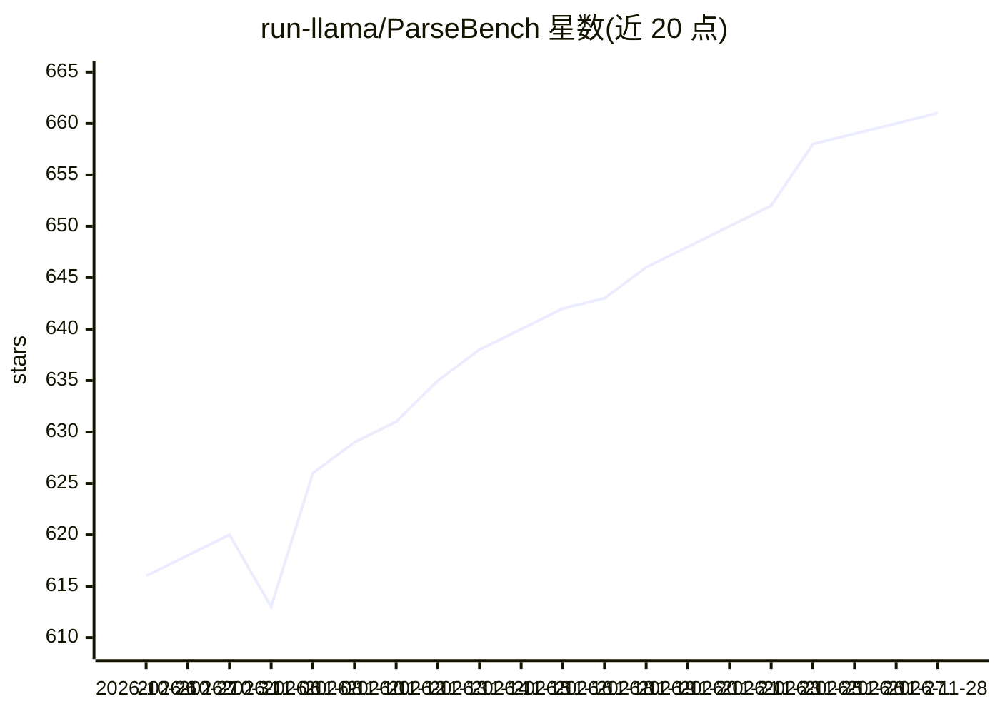

# run-llama/ParseBench

⭐ 661 · Python · Apache-2.0 · 推送 2026-11-27 · [GitHub](https://github.com/run-llama/ParseBench) · [官网](https://arxiv.org/abs/2604.08538) · 组织维护

**面向 AI agent 场景的文档解析工具评测基准**

ParseBench 是一个评测文档解析工具的基准：测试各解析器将 PDF 转为结构化输出时，是否保留供 agent 自主决策所需的结构与语义。v1 覆盖约 2,000 页经人工核验的企业文档（保险、金融、政府），按表格、图表、内容忠实性、语义格式、视觉定位五个维度评分；ParseBench 2 扩展至 4,317 个用例并加入表单维度与按严重度加权的计分。以 pip 包形式提供 CLI（parse-bench），内置 180+ 个待评测 pipeline，数据集托管于 HuggingFace，运行评测需配置解析工具的 API key。

## 筛选速览

| 维度 | 判定 | 备注 |
|---|---|---|
| AI 角色 | `ai-ecosystem` | LLM/agent 周边工具 |
| 许可风险 | `permissive` | Apache-2.0 |
| 部署形态 | `library` | 以包/库形式分发 |
| 模型依赖 | — | README 未给出锁定关系 |
| 硬件要求 | — | 无带数字的原话,不猜 |
| 安装摩擦 | `low` | 无编译、无系统依赖或容器化 |
| 成熟度 | — | 结构信号不足 |

## 能力要点

- 六个能力维度 + severity-aware 计分（页面得分取内容恢复分与严重度上限的较小值）
- 内置 180+ 个评测 pipeline，含 LlamaParse、OpenAI、Anthropic、Gemini、Azure/Textract 等管线
- 自托管评分器与可验证排行榜：发布原始输出后自动重评分
- 支持评测自有解析器（按 results layout 写入后运行 evaluation 命令）

## 适用场景

- 为 agent 工作流选型文档解析工具前跑分对比
- 评测自己开发的 PDF 解析器在表格/图表/格式保持上的表现
- 获取带严重度分级的解析错误指标用于回归测试

## 场景标签

`模型评测` `文档解析` · 领域:评测与运维

## 证据(README 行号)

> L15: **ParseBench** is a benchmark for evaluating how well document parsing tools convert PDFs into structured output th
> L109: A **pipeline** is a document parsing tool or configuration that you want to evaluate. There are 180+ pipelines ava
> L98: **Prerequisites:** Create a `.env` file with the API key for the parsing tool you want to evaluate (see Configurati

## 星数曲线

2026-10-26 616 → 2026-11-28 661（+45）

---
*卡片 v1 · prompt 1.4 · 生成 2026-11-26 · 置信度 high · 依据 README sha `a6512a822059` · [字段定义](../../DATASET.md)*
