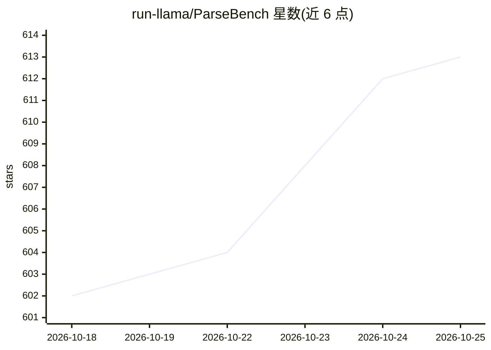

# run-llama/ParseBench

⭐ 613 · Python · Apache-2.0 · 推送 2026-10-23 · [GitHub](https://github.com/run-llama/ParseBench) · [官网](https://arxiv.org/abs/2604.08538) · 组织维护

**面向 AI Agent 的文档解析基准：评测 PDF 转结构化输出的可靠性**

由 LlamaIndex（run-llama）发布的文档解析评测基准：约 2,000 页来自保险、金融、政府真实企业文档的人工标注数据，按表格、图表、内容忠实度、语义格式、视觉溯源五个能力维度组织。以 Python 包（PyPI）提供，通过 CLI 调用被评测的解析工具（180+ pipeline，含 LlamaParse、OpenAI、Anthropic、Google、Docling 等）运行推理并评分，默认全部确定性规则化评测，不使用 LLM-as-a-judge，输出 HTML 报告、排行榜与 CSV/JSON 导出。数据集托管于 HuggingFace，运行时自动下载，仅需被评测工具的 API key。

## 筛选速览

| 维度 | 判定 | 备注 |
|---|---|---|
| AI 角色 | `ai-ecosystem` | LLM/agent 周边工具 |
| 许可风险 | `permissive` | Apache-2.0 |
| 部署形态 | `library` | 以包/库形式分发 |
| 模型依赖 | — | README 未给出锁定关系 |
| 硬件要求 | — | 无带数字的原话,不猜 |
| 安装摩擦 | `low` | 无编译、无系统依赖或容器化 |
| 成熟度 | — | 结构信号不足 |

## 能力要点

- 约 2,078 页人工验证页、1211 份文档、169,011 条规则，分五个能力维度
- 180+ 可评测 pipeline，覆盖 21 个论文基线
- 默认确定性规则化评测，不使用 LLM-as-a-judge
- 生成 HTML 明细报告、跨工具排行榜与 CSV/Markdown/JSON 导出

## 适用场景

- 对比选型 PDF 解析工具在表格/图表等维度的表现
- 为自己的解析工具跑基准并加入排行榜
- 审计受监管流程中解析结果的视觉溯源能力

## 场景标签

`模型评测` `文档解析` · 领域:评测与运维

## 证据(README 行号)

> L11: **ParseBench** is a benchmark for evaluating how well document parsing tools convert PDFs into structured output th
> L118: The `run` command runs inference (calls the parsing tool), evaluates the results against ground truth, and generat
> L176: By default ParseBench does **not** use LLM-as-a-judge — all evaluation is deterministic and rule-based, and API ke

## 星数曲线

2026-10-18 602 → 2026-10-25 613（+11）

---
*卡片 v1 · prompt 1.4 · 生成 2026-10-21 · 置信度 high · 依据 README sha `cf022f11f8ce` · [字段定义](../../DATASET.md)*
