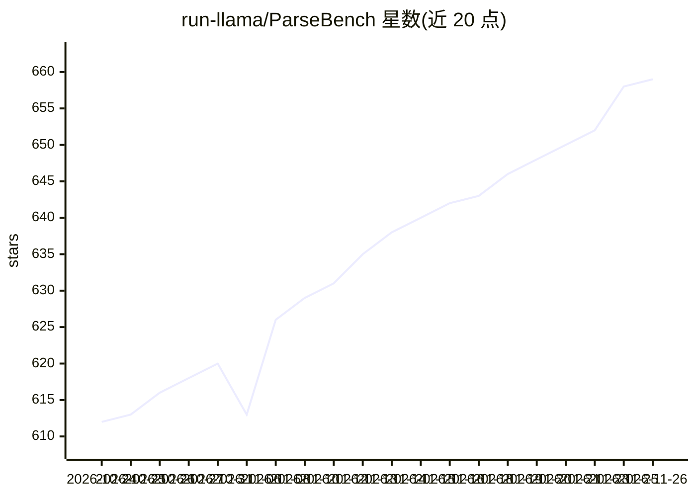

# run-llama/ParseBench

⭐ 659 · Python · Apache-2.0 · 推送 2026-11-25 · [GitHub](https://github.com/run-llama/ParseBench) · [官网](https://arxiv.org/abs/2604.08538) · 组织维护

**评测文档解析工具能否为 AI Agent 产出可用结构化输出的基准**

ParseBench 是一个文档解析基准：用人工核验的企业文档（保险、金融、政府）页面，评测各解析工具将 PDF 转为结构化输出后是否保留 Agent 决策所需的结构与含义。覆盖文本、格式、表格、图表、版面、表单六个维度，采用严重度感知评分（每页取内容恢复分与严重度上限的较低值），检测 140+ 类错误。提供 parse-bench CLI，运行 pipeline 下载 HuggingFace 数据集、产出分数与排行榜；支持自建 parser 输出接入评分，收录 180+ 个 pipeline。

## 筛选速览

| 维度 | 判定 | 备注 |
|---|---|---|
| AI 角色 | `ai-knowledge` | 知识聚合/清单类 |
| 许可风险 | `permissive` | Apache-2.0 |
| 部署形态 | `library` | 以包/库形式分发 |
| 模型依赖 | local-ok | 支持本地模型 |
| 硬件要求 | — | 无带数字的原话,不猜 |
| 安装摩擦 | `low` | 无编译、无系统依赖或容器化 |
| 成熟度 | — | 结构信号不足 |

## 能力要点

- ParseBench 2 含 4,317 个页面级测试用例、六维度严重度感知评分
- 检测 140+ 类错误类型，指标按 330 个受控场景校准
- 支持将自己的 parser 输出按结果布局接入评分
- 提供 180+ 个 pipeline 与可排序筛选的在线排行榜

## 适用场景

- 在接入 Agent 工作流前评测各文档解析器的结构保真度
- 为自己的 PDF 解析器获取六维度分数与错误定位
- 按每页成本与分数筛选商业或开源解析方案

## 场景标签

`模型评测` `文档解析` · 领域:评测与运维

## 证据(README 行号)

> L15: **ParseBench** is a benchmark for evaluating how well document parsing tools convert PDFs into structured output th
> L17: The original benchmark (ParseBench v1) covers ~2,000 human-verified pages from real enterprise documents (insurance

## 星数曲线

2026-10-24 612 → 2026-11-26 659（+47）

---
*卡片 v1 · prompt 1.4 · 生成 2026-11-25 · 置信度 high · 依据 README sha `7ebf5186d9c9` · [字段定义](../../DATASET.md)*
