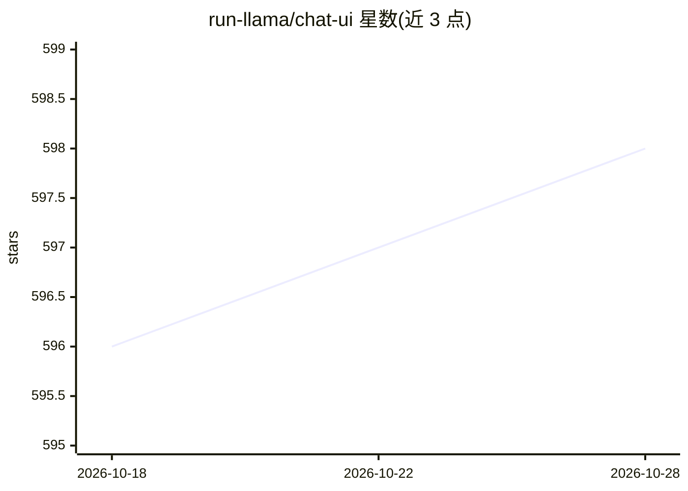

# run-llama/chat-ui

⭐ 598 · TypeScript · MIT · 推送 2025-12-16 · [GitHub](https://github.com/run-llama/chat-ui) · [官网](https://ui.llamaindex.ai/) · 组织维护

**为 LLM 应用开发者提供 React 聊天界面组件库**

@llamaindex/chat-ui 是基于 React 与 shadcn/Tailwind CSS 的聊天 UI 组件库，面向用 Next.js/React 构建 LLM 应用的开发者。提供消息气泡、输入框、ChatSection 等预构建组件，可与 vercel/ai 的 useChat hook 连接 LLM 后端；支持通过自定义子组件与 useChatUI/useChatInput hook 扩展，内置代码高亮（highlight.js）、LaTeX（katex）、PDF 渲染及 mermaid 等自定义语言渲染器。可通过 shadcn CLI 或 npm 安装，MIT 许可。

## 筛选速览

| 维度 | 判定 | 备注 |
|---|---|---|
| AI 角色 | `ai-ecosystem` | LLM/agent 周边工具 |
| 许可风险 | `permissive` | MIT |
| 部署形态 | `library` | 以包/库形式分发 |
| 模型依赖 | — | README 未给出锁定关系 |
| 硬件要求 | — | 无带数字的原话,不猜 |
| 安装摩擦 | `low` | 无编译、无系统依赖或容器化 |
| 成熟度 | — | 结构信号不足 |

## 能力要点

- 预构建聊天组件（消息气泡、输入框、ChatSection 等），Tailwind CSS 可定制样式
- 与 vercel/ai 的 useChat hook 集成连接 LLM 后端
- 自定义 widget 扩展与 useChatUI/useChatInput hook 向聊天 API 端点发送附加数据
- 代码/LaTeX/PDF 渲染支持与自定义语言渲染器（如 mermaid 转 SVG）

## 适用场景

- 为 LLM 应用快速搭建聊天界面
- 通过自定义组件渲染生成或检索到的文档
- 扩展组件以连接自己的模型后端（如 LlamaCloud）

## 场景标签

 · 领域:LLM 应用前端组件

## 证据(README 行号)

> L7: @llamaindex/chat-ui is a React component library that provides ready-to-use UI elements for building chat interfaces
> L31: - Easy integration with LLM backends like Vercel Ai

## 星数曲线

2026-10-18 596 → 2026-10-28 598（+2）

---
*卡片 v1 · prompt 1.4 · 生成 2026-10-21 · 置信度 high · 依据 README sha `6ad36efe6063` · [字段定义](../../DATASET.md)*
