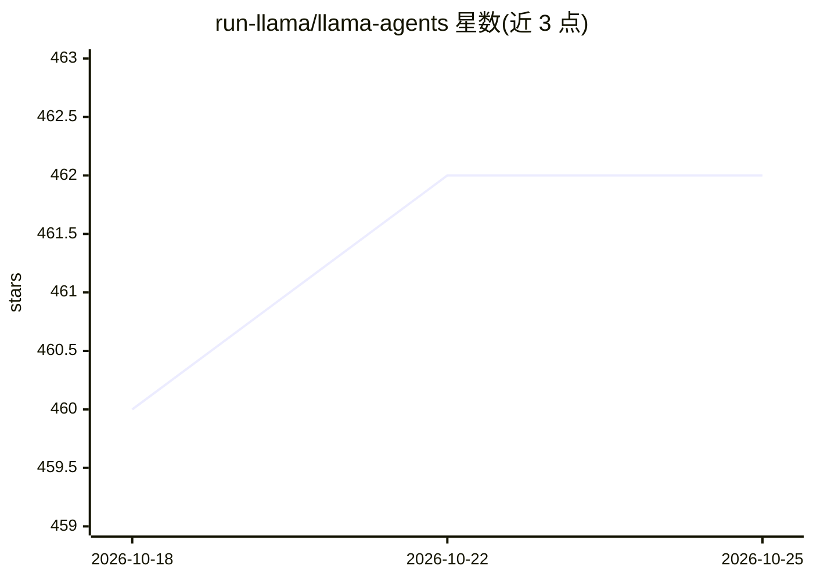

# run-llama/llama-agents

⭐ 462 · Python · MIT · 推送 2026-10-23 · [GitHub](https://github.com/run-llama/llama-agents) · [官网](https://www.llamaindex.ai/) · 组织维护

**构建与部署文档中心 AI agent 的 Python 编排框架**

基于事件驱动的 Agent Workflows 构建的开源 Python 框架，面向把 OCR、LLM、结构化抽取、分类、人工审核组合成可靠生产管线的文档类 agent 场景。步骤为异步 Python 函数，支持分支、循环、并行、状态持久化与故障恢复，无 DSL。可作库嵌入脚本/服务器，可经 llama-agents-server 封装为 REST API，或用 llamactl CLI 部署到 LlamaParse、AWS Bedrock AgentCore 等目标。

## 筛选速览

| 维度 | 判定 | 备注 |
|---|---|---|
| AI 角色 | `ai-ecosystem` | LLM/agent 周边工具 |
| 许可风险 | `permissive` | MIT |
| 部署形态 | `library` | 以包/库形式分发 |
| 模型依赖 | — | README 未给出锁定关系 |
| 硬件要求 | — | 无带数字的原话,不猜 |
| 安装摩擦 | `low` | 无编译、无系统依赖或容器化 |
| 成熟度 | — | 结构信号不足 |

## 能力要点

- 事件驱动编排：异步 Python 步骤、分支/循环/并行/持久化/故障恢复
- llama-agents-server 将任意 workflow 封装为带流式与 human-in-the-loop 的 REST API
- llamactl CLI 端到端构建与部署 agent（可部署为 MCP server 或带 UI 应用）
- 可作为库嵌入 notebook、FastAPI 应用或客户受控环境

## 适用场景

- 把 OCR、LLM、抽取、人工审核组装为可上生产的文档处理管线
- 在文档不能外发的客户环境中运行 agent 工作流
- 将已有 workflow 快速封装为 REST 服务供其他系统调用

## 场景标签

`Agent 框架` · 领域:Agent 开发

## 证据(README 行号)

> L12: An open-source framework for building and shipping document-centric agents in Python.
> L16: LlamaAgents is built on **Agent Workflows**, an event-driven orchestration library where steps are async Python fun

## 星数曲线

2026-10-18 460 → 2026-10-25 462（+2）

---
*卡片 v1 · prompt 1.4 · 生成 2026-10-21 · 置信度 high · 依据 README sha `76f2d8fda5c6` · [字段定义](../../DATASET.md)*
