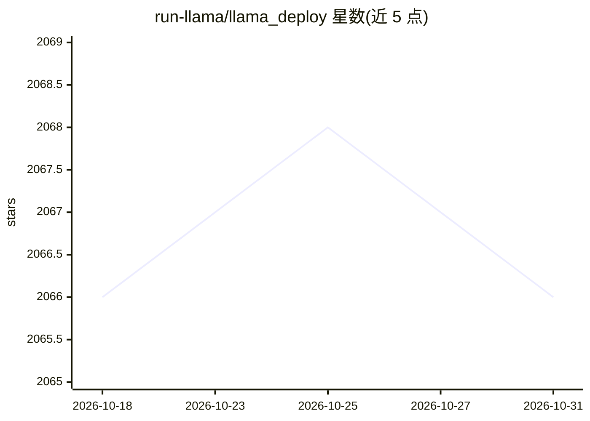

# run-llama/llama_deploy

⭐ 2,066 · Python · MIT · 推送 2026-04-06 · [GitHub](https://github.com/run-llama/llama_deploy) · [官网](https://docs.llamaindex.ai/en/stable/module_guides/llama_deploy/) · 组织维护

**将 LlamaIndex agent 工作流部署到生产环境的框架（已弃用）**

LlamaDeploy 是 LlamaIndex 团体的项目，用于把 agentic workflows 部署到生产环境，支持多 agent 主题。README 明确声明项目已弃用，官方建议改用 llama-agents 来服务工作流。以 Python 包形式分发，通过 PyPI 安装，仓库带有单元测试、E2E 测试与覆盖率徽章。可见 README 内容较短，仅含徽章与弃用公告，功能细节有限。

## 筛选速览

| 维度 | 判定 | 备注 |
|---|---|---|
| AI 角色 | `ai-ecosystem` | LLM/agent 周边工具 |
| 许可风险 | `permissive` | MIT |
| 部署形态 | `library` | 以包/库形式分发 |
| 模型依赖 | — | README 未给出锁定关系 |
| 硬件要求 | — | 无带数字的原话,不猜 |
| 安装摩擦 | `low` | 无编译、无系统依赖或容器化 |
| 成熟度 | — | 结构信号不足 |

## 能力要点

- 用于部署 agentic workflows 到生产环境
- 主题覆盖 agents、deployment、multi-agents
- 官方已弃用，建议迁移至 llama-agents

## 适用场景

- 将 LlamaIndex 工作流部署为服务（历史用途，现已弃用）
- 作为 llama-agents 的前身项目了解其演进

## 场景标签

`多智能体` `Agent 框架` · 领域:Agent 开发

## 证据(README 行号)

> L10: # 🦙 LlamaDeploy 🤖
> L13: > **This project is deprecated.** To serve workflows, use llama-agents instead.

## 星数曲线

2026-10-18 2,066 → 2026-10-31 2,066（+0）

---
*卡片 v1 · prompt 1.4 · 生成 2026-10-21 · 置信度 mid · 依据 README sha `9d8a50f69613` · [字段定义](../../DATASET.md)*
