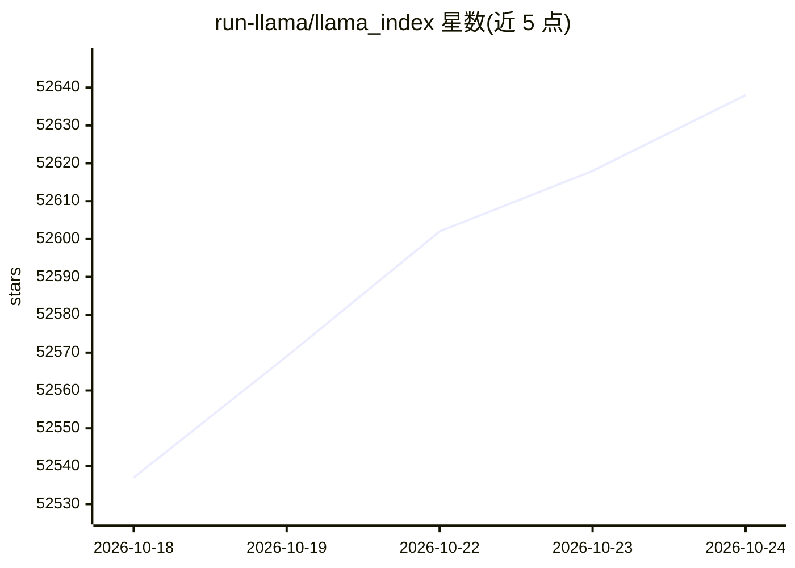

# run-llama/llama_index

⭐ 52,638 · Python · MIT · 推送 2026-10-23 · [GitHub](https://github.com/run-llama/llama_index) · [官网](https://developers.llamaindex.ai) · 组织维护

**构建 LLM/Agent 应用的开源数据框架（RAG 工具集）**

LlamaIndex 是一个帮助开发者构建 LLM 应用与 agentic 应用的开源数据框架：提供数据连接器（APIs、PDFs、docs、SQL 等）接入私有数据，以索引/图结构组织数据，并给出检索/查询接口，使 LLM 能基于私有数据生成知识增强输出。采用核心包加 300+ 集成插件的架构，可搭配任意 LLM、嵌入模型与向量库。高层 API 可 5 行代码完成数据摄取与查询，底层 API 支持定制各模块。维护方公司当前主要重心已转向 LlamaParse 平台。

## 筛选速览

| 维度 | 判定 | 备注 |
|---|---|---|
| AI 角色 | `ai-ecosystem` | LLM/agent 周边工具 |
| 许可风险 | `permissive` | MIT |
| 部署形态 | `library` | 以包/库形式分发 |
| 模型依赖 | local-ok | 支持本地模型 |
| 硬件要求 | — | 无带数字的原话,不猜 |
| 安装摩擦 | `low` | 无编译、无系统依赖或容器化 |
| 成熟度 | — | 结构信号不足 |

## 能力要点

- 数据连接器摄取 APIs/PDFs/docs/SQL 等多种数据源
- 索引/图结构组织数据，提供检索与知识增强查询接口
- 300+ 集成包，可搭配自选 LLM、嵌入与向量库提供商
- 核心包内置 nltk 与 tiktoken 缓存，适应受限磁盘环境

## 适用场景

- 把企业私有文档接入 LLM 做 RAG 问答
- 用 Ollama 或 HuggingFace 模型本地构建向量索引与查询
- 定制数据连接器、检索器、查询引擎等模块构建应用

## 场景标签

`RAG` `Agent 框架` · 领域:Agent 开发

## 证据(README 行号)

> L82: That's where **LlamaIndex** comes in. LlamaIndex is a "data framework" to help you build LLM apps. It provides the 
> L84: - Offers **data connectors** to ingest your existing data sources and data formats (APIs, PDFs, docs, SQL, etc.).
> L86: - Provides an **advanced retrieval/query interface over your data**: Feed in any LLM input prompt, get back retriev

## 星数曲线

2026-10-18 52,537 → 2026-10-24 52,638（+101）

---
*卡片 v1 · prompt 1.4 · 生成 2026-10-20 · 置信度 high · 依据 README sha `88ce08edabec` · [字段定义](../../DATASET.md)*
