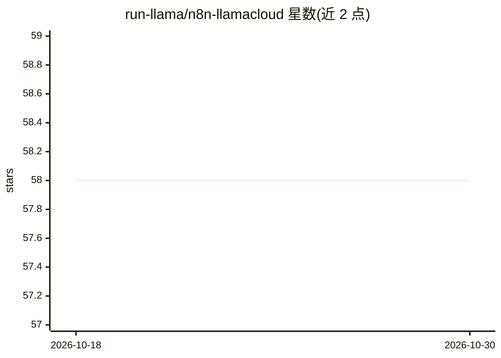

# run-llama/n8n-llamacloud

⭐ 58 · TypeScript · MIT · 推送 2026-07-13 · [GitHub](https://github.com/run-llama/n8n-llamacloud) · [官网](https://run-llama.github.io/n8n-llamacloud/) · 组织维护

**在 n8n 工作流中接入 LlamaCloud 的社区节点**

提供单个 n8n 社区节点 LlamaParse Platform，将 LlamaCloud 的文档解析、分类、语义切分、结构化提取与索引检索五类 API 暴露到 n8n 工作流中，供使用 n8n 构建自动化流程与 RAG 应用的工作流开发者使用。节点标记 usableAsTool，可作为 n8n AI Agent 的工具；需自备 LlamaParse Platform API key，本地开发要求 Node.js ≥ 20 与全局安装的 n8n。提供 npm 安装、源码开发与 Docker 三种方式，MIT 许可。

## 筛选速览

| 维度 | 判定 | 备注 |
|---|---|---|
| AI 角色 | `ai-ecosystem` | LLM/agent 周边工具 |
| 许可风险 | `permissive` | MIT |
| 部署形态 | `self-host` | docker 或自建部署 |
| 模型依赖 | — | README 未给出锁定关系 |
| 硬件要求 | — | 无带数字的原话,不猜 |
| 安装摩擦 | `low` | 无编译、无系统依赖或容器化 |
| 成熟度 | — | 结构信号不足 |

## 能力要点

- 单一节点暴露五类资源：Parse/Classify/Split/Extract/Retrieve
- Retrieve 兼容 LlamaCloud Index v1 Pipelines 与 v2 Retrieval API
- usableAsTool 标记使各资源可作为 n8n AI Agent 的工具
- 提供 npm/源码/Docker 三种安装运行方式

## 适用场景

- 在 n8n 工作流中把 PDF/DOCX 等文档解析为 Markdown 文本
- 为 n8n AI Agent 挂载 LlamaCloud 索引检索工具构建 RAG 流程
- 用预配置 LlamaExtract agent 从文档提取符合 schema 的 JSON

## 场景标签

`文档解析` `RAG` · 领域:知识与检索

## 证据(README 行号)

> L3: This repository contains a custom n8n community node for integrating with the LlamaParse Platform, bringing document
> L41: > The node is also marked `usableAsTool: true`, so any of the resources above can be wired into an n8n AI Agent as 

## 星数曲线

2026-10-18 58 → 2026-10-30 58（+0）

---
*卡片 v1 · prompt 1.4 · 生成 2026-10-24 · 置信度 high · 依据 README sha `d241ddd799dd` · [字段定义](../../DATASET.md)*
