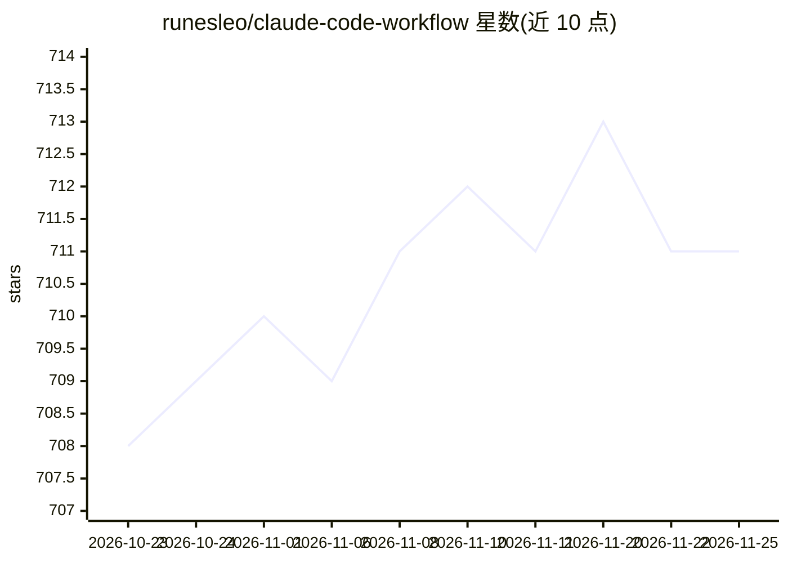

# runesleo/claude-code-workflow

⭐ 711 · Python · MIT · 推送 2026-11-13 · [GitHub](https://github.com/runesleo/claude-code-workflow) · [官网](https://leolabs.me) · 个人维护 · 中文 README

**给 Claude Code/Codex/Cursor 用的轻量可回滚行为边界系统**

QuietHarness 是一套为 Claude Code、Codex、Cursor 三种 AI 编程 Agent 提供共享工作边界的配置系统，v3 将常驻规则压缩为约 2,318 字节的三份模板（shared AGENTS.md、CLAUDE.md 薄入口、Cursor .mdc 项目规则），只需安装其中一种客户端即可获得同一组核心行为。安装脚本提供 dry-run 预览、--apply 写入、带时间戳备份与回滚，不联网、不需要 API key。附任务状态记录、单 Writer 写锁、会话收尾等协议文档，以及 Leo System 与多个实验层作为可选扩展。

## 筛选速览

| 维度 | 判定 | 备注 |
|---|---|---|
| AI 角色 | `ai-ecosystem` | LLM/agent 周边工具 |
| 许可风险 | `permissive` | MIT |
| 部署形态 | `None` |  |
| 模型依赖 | — | README 未给出锁定关系 |
| 硬件要求 | — | 无带数字的原话,不猜 |
| 安装摩擦 | `low` | 无编译、无系统依赖或容器化 |
| 成熟度 | `idea` | |

## 能力要点

- 三端共享 1,604 字节 Core 模板，任选一个客户端即可安装
- 安装器默认 dry-run 预览，--apply 写入并创建带时间戳备份，可回滚
- 任务系统以 per-task 文件记录 status/artifact/writeback，聊天记忆不作为持久状态
- 提供隔离项目首次成功练习作为安装后行为验收

## 适用场景

- 给正在维护真实项目的 AI 编程 Agent 加上先看现状、按风险验证、不可逆动作先确认的边界
- 同时使用 Claude Code、Codex、Cursor 时复用同一套行为配置
- 多模型并行研究同一仓库时用单 Writer 写锁避免相互覆盖

## 场景标签

`编码 Agent` `提示工程` · 领域:Agent 开发

## 证据(README 行号)

> L7: > 给你已经在使用的 AI 编程 Agent 装上一层极小、可回滚的工作边界：先看现状、保留无关改动、按风险验证、对不可逆动作先确认。
> L9: **只用 Claude Code、Codex 或 Cursor 中的一个就能获得同一组核心可靠性边界。** 多端兼容是以后更换工具时可以带走这些边界，不是安装门槛。
> L141: Claude Code、Codex 和 Cursor 都能获得同一组核心可靠性行为，但你只需要安装自己正在使用的客户端。Codex 直接读取 shared `AGENTS.md`，Claude Code 通过薄入口引用它；Cur

## 星数曲线

2026-10-23 708 → 2026-11-25 711（+3）

---
*卡片 v1 · prompt 1.4 · 生成 2026-11-24 · 置信度 high · 依据 README sha `ae259116c45c` · [字段定义](../../DATASET.md)*
